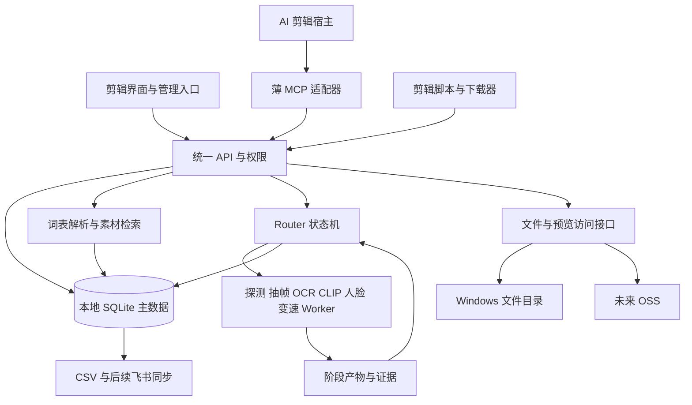

# 素材库设计总览

2026-11-11设计补充（拟定、未实现）：[清洗与十维度打标方案](cleaning-and-topic-tagging-plan.md)划分原件登记、标准副本清洗、输出验证/复核、本地粗分类、多模态十字段初稿、标签规范化与字段审核；标签绑定实际分析版本，清洗配方/时间映射/命名另存，隐私复核和医学审核分别保留。模型适配可替换，具体精标提供方后置；现有四字段Worker及运行服务不变。

2026-11-10 M-014：云端在线打码/变速由独立media-cloud Worker负责，不等待本地标签；本仓仅升级共享合同固定依赖0.3.0，既有Router/处理保持。实现/隔离证据与边界见control-center/tasks/M-014及media-cloud/docs/online-processing.md，未生产部署。

2026-11-10 M-011：多人云收件→本地主动拉取/事务判重→实际模型初稿→增量发布/云采用回执已实现，隔离验证与范围见[收件同步](cloud-intake-sync.md)。真实OSS/ECS配置后补，本轮不生产部署、不改现有本地实例。下文早期未实现描述保留历史背景，以本补充为准。

2026-11-10双仓首轮更新：用户已授权M-006，media-tag保留本地打标，media-cloud独立维护发布接收/查询下载；当前实现与范围以[双仓发布说明](cloud-publication.md)为准。下文单仓建议保留为历史背景，已由双仓决定替代；首轮不生产部署，真实OSS/ECS、云端处理、收件与企业认证尚待后续。

整理日期：2026-11-07。状态：设计基线，D00～D04、D06、D09～D15工程已验收，见 [D00说明](contracts.md)、[D01说明](catalog-storage.md)、[D02说明](media-evidence.md)、[D03说明](router-queue.md)、[D09说明](upload-variants.md)，D17[文件基础](file-access.md)已实现，公共检索契约也已实现（[说明](asset-search-api.md)），真实跨端业务仍待验收。业务边界见 [REQUIREMENTS.md](REQUIREMENTS.md)；HTTP上传/调度、衍生契约及授权文件基础已实现，[D04模型Worker](model-workers.md)已实现并完成本机推理验证；[D10人脸打码](face-redaction.md)已实现核心/接口与本机验证；[D11固定变速/组合](fixed-retime.md)已实现；D15受权术语检索/反馈/管理页已实现（[说明](search-feedback.md)），D17公共取材语义协议已实现，MCP/剪辑宿主与部署仍待后续，不能把设计图视为运行事实。

## 设计决策

2026-11-09目标部署已改为本地打标、阿里云查询下载；已有服务器和OSS。推荐一个仓库、两个独立部署入口，加本地发布组件；详见[拟定方案](aliyun-deployment-plan.md)。以下区分既有本地实现与尚待实施的双端结构。

| 决策 | 当前结论 | 状态 |
| --- | --- | --- |
| 人员界面 | 极简、画廊默认、列表可切换；视频处理独立；标签后台运行 | D12处理页/入库已实现；D06医学字段管理/CSV已接入，D15检索/词表管理已接入，业务校准待D16 |
| 企业网站与账号 | 企业Vue承载素材模块，企业Python验证原登录后传受信身份，素材服务保留能力/对象权限；账号生命周期独立于目录快照 | 用户已明确Python/Vue，协议/项目未取得；[对接方案](enterprise-integration.md)拟定，当前仍本机凭证/会话 |
| 术语解析 | 已发布词表＋文本小模型；多义、关系和否定独立处理 | 用户已选定路线；具体模型待实测 |
| 权威数据 | 本地主SQLite写素材目录/标签，云端采用查询快照；投稿/传输台账独立，不做双向主库同步 | 本地主库已实现；收件/登记桥接、查询发布包及云端副本待实现 |
| 团队部署 | 本地Windows负责打标/目录管理；云端查询/收件与常在线处理Worker分离，当次取结果后后台入库 | 8GB云机能否同机处理需实测；双端共用库/独立Worker拟定，云端尚未部署 |
| 存储访问 | 本地保留原件及CAS，私有OSS存云端素材/预览/必要证据；稳定入口隔离物理路径 | 本地后端已实现；OSS仍为未配置占位，D08 OSS提前当前主线 |
| AI 接入 | HTTP API 为公共能力，MCP 为薄适配层，剪辑端负责下载和当前用途检查 | 推荐方案，Q04/Q05 |
| 模型运行 | 确定性工具＋专用小模型；可选 VLM；GPU 重任务全局串行 | D04本机CPU/CUDA实测及队列适配已实现；正式词表/代表性校准、最终主机与可选VLM仍待后续 |
| 人工管理 | 词表、医学标签审核、来源修订和导出放管理入口 | D06字段复核/CSV已实现；D13词表服务已实现、D15维护页面已实现，实际审核角色由Q03指定 |

## 总体结构

下图是已有本地完整服务的模块结构；目标双端结构及发布流程以[云端方案](aliyun-deployment-plan.md)为准，图中的“未来OSS”当前仍未实现。

Router 是确定性调度程序，负责依赖、租约、幂等、取消及资源配额；Worker 是执行固定职责的进程。“开发时分派任务的 Router/Worker”和系统运行时进程分开记录。普通查询不需要启动一条视觉分析流水线，下载也不依赖模型可用。

## 模块与职责

| 模块 | 负责 | 不承担 |
| --- | --- | --- |
| 素材登记 | 上传完成校验、去重、来源记录、身份与版本 | 不因同字节合并许可或账号可见范围 |
| 文件服务 | 授权访问、Range、固定哈希下载、预览描述、后端切换 | 不暴露任意盘符/路径或永久签名链接 |
| 后台分析 | 技术事实、抽帧/OCR/模型建议及证据 | 不确认医学结论、许可或人工身份 |
| 视频处理 | 完整片段人脸轨迹、遮罩、速度/音频、输出校验 | 不用稀疏抽帧检测冒充完整打码 |
| 词表服务 | 概念/别名审核、不可变发布、上下文解析、文本候选召回 | 不把相关关系变同义、不自动新增锁定分类 |
| 素材检索 | 有权限候选、匹配理由、实际版本与片段时间 | 不把 AI 建议当有效医学标签，不替代看片 |
| 管理审核 | 逐字段采用、冲突处理、输出复核、词表发布 | 各审核状态互不替代 |
| AI 接入 | 统一查询/详情/预览/下载清单；剪辑任务内取得实际文件 | 不改相邻项目共享素材、旧任务或最终导出策略 |
| 导出同步 | 一致快照 CSV；后续飞书差异同步/冲突处理 | 不直接把飞书或 CSV 变成另一个无规则主库 |

## 三条业务链路

双端新增输入：人员云端上传→服务端核验实际字节→待入库收件箱→本地主动拉取→主库精确判重/幂等登记→本地打标→配对发布回云。云端只按已发布索引初判，本地主库确认；收件台账独立于查询快照，发布/回退不丢上传。物理去重不合并来源/权限；管理页与桥接仍拟定，见[细则](aliyun-deployment-plan.md)。

当次取处理结果为独立在线链路：上传校验→常在线Worker执行打码/变速→实际输出校验→按隐私复核门槛预览/下载，不等本地主库登记、语义打标或发布。处理台账/输出复核也独立于查询快照；本地关机只延迟后台入库。8GB同机处理或独立云节点依规格/并发/可等待时间实测选择，尚未实现。

1. 素材库上传：上传完整性校验 → 原件登记 → 自动派发探测/分析 → 标签建议 → 人工修订 → 索引/表格。原件和候选的可见范围由权限决定，未知状态不得写成“没有”。
2. 独立视频处理：直接上传或选择库内有权版本 → 选择打码/变速 → 处理输出 → 连续预览与复核 → 下载或主动加入素材库 → 后台更新属性/标签。技术探测是处理前提，语义打标成功不是。
3. AI 取材：镜头需求 → 口语/专业词检索 → 看候选实际预览 → 选择固定 asset_id/hash/片段 → 剪辑端下载校验 → 当前用途检查 → 加入本次剪辑。查到、可下载、适用、已医学审核是不同结论。

人员主导航拟定为“素材库、视频处理、我的任务”，管理入口按权限显示。术语补充在搜索旁轻量提交，管理端独立审核/试搜/发布，详细交互保留在术语专题第 9 节。

## 数据与时间约定

- 每个可下载素材版本拥有自己的 asset_id、不可变文件哈希；root_asset_id 将原件和衍生版本归为一组，parent_asset_id 表示直接来源。metadata revision 表示该版本记录的修订，不表示可以替换该 ID 对应的文件字节。
- blob 保存内容身份；source 保存来源、许可、旧 ID 和原话；storage_location 保存实际后端。相同 blob 可有多个来源，不自动合并授权。
- tag_suggestion 与 effective_tag 分开；人工字段修订带身份、证据与版本。taxonomy 限定正式标签值，lexicon 负责口语映射，两者分别发布。
- 处理配方保存源哈希、速度、音频策略、轨迹修订、软件/模型版本、输出哈希和 time_map。片段时间绑定实际文件版本；默认 1.0 倍，变更配方从登记的基准生成，不隐式叠加倍速。
- 任务、尝试、租约、错误、报告由服务端维护；任务目录保存阶段产物。默认最多 3 次总尝试（含首次），旧租约结果不得发布；成功阶段按输入及版本指纹复用。
- 表格保持原始素材表 35 列、缺口表 14 列。模板不能表达的未知/混合/运行状态留在内部质量报告，不擅改表头或塞假值。

## 技术选型与资源约束

Python、FastAPI、SQLite、FFmpeg/ffprobe 为当前工程方向；D00已落地Python 3.12、Pydantic结构校验、setuptools及pytest，实际版本/哈希见依赖锁。D12已落地FastAPI同源HTML/CSS＋原生JavaScript，轨迹修订使用浏览器canvas，资源随wheel分发，不需要Node生产工具链。HTTP服务与人员处理页/入库已实现，D06字段复核/CSV已实现，D15受权术语检索已实现，常驻部署与独立效果验收未完成；未来引入框架时先记录需求与影响。各接口先定 JSON Schema/错误/权限契约，不先搭多个框架或服务。

OCR、YuNet、Chinese-CLIP 和 BGE-small 是现有方案候选，具体版本在独立环境实测后锁定；VLM 为后置选项。32GB 内存和 8GB 显存不能据此认定任何模型组合已兼容。GPU 重推理/硬件编码共用配额，不能按不同队列各自占满显存；搜索和文件服务保持可响应。

本机Windows及Codex链路已有工程证据。下一步需要真实阿里云查询API、HTTPS与跨端下载闭环；stdio薄适配器可连接云端HTTP origin，宿主仍需实际联调。文件上传OSS与索引/权限发布是两项配套工作，单独上传媒体不会使检索服务上线。

D19本仓库客户端已实现任务内固定版本下载/解码、Range恢复、来源与当前用途交接，见 [说明](editing-provider.md)。本轮明确维护实际剪辑仓库`D:/ai/auto-video`，E:/asset保存取材，显式新任务CLI、原隐私处理/登记/验收与实时来源验证已接通，见[实际接入](editing-host.md)；旧任务/共享素材/预览与导出策略不变。交接单固定预览终点/医学pending，不能据此报告宿主已采用或完成预览。

## 发布与数据边界

生产数据/表格/模板不进 Git，代码与合成夹具进入版本控制。下载接口先校验身份和对象权限，失效/撤回不静默换成另一版；输出失败不损坏上次有效结果。打码预览、缩略图必须来自正确输出，不能泄露原脸。

部署使用受控账号、可恢复的数据库及对象备份；真实恢复演练属于验收。D08 OSS已进入当前主线，飞书继续后置。云端只接受完整发布版本，查询不能顺带恢复队列或更新初稿投影；凭证/会话与本地分开，权限收紧同步和回退保持限制见[拟定方案](aliyun-deployment-plan.md)。跨项目规则仍按原明确范围执行。

D07 [离线维护](offline-recovery.md)已实现SQLite备份接口、全部本地CAS对象及任务证据的固定清单、全新目录还原与引用核验；实际本机隔离HTTP/BGE恢复通过。它要求停服/停止Worker，不是在线跨文件快照；不包含模板、权重或运行凭证文件，也不自动部署常驻服务。正式Windows机器/跨端业务签收仍待条件。

## 专题设计与验收依据

- [存储、字段归属、A01～A11 验收及 AI 接入](DESIGN_AND_IMPLEMENTATION.md)：第 4～6、10、12 节。
- [模型、任务协议与 D00～D08](MODEL_ROUTER_WORKER_PLAN.md)：模型候选、租约、重试、资源和产物协议。
- [D06字段复核与CSV](review-csv.md)：证据/人工有效值、整行状态、缺口与原子快照。
- [D12人员页面与入库](personnel-ui.md)：会话、私有处理、指定人输出复核、明确版本入库与共享。
- [上传、人脸与变速 D09～D12](UPLOAD_AND_MEDIA_VARIANTS.md)：完整视频处理和版本关系。
- [词表与小模型 D13～D16](TERMINOLOGY_MAPPING_PLAN.md)：发布契约、交互及 T01～T12/业务评测。

总控文档确定范围、设计状态和实施顺序；专题保留字段与算法细节；冲突先检查本轮明确修订，不把旧阶段排期重新当作当前主线。

2026-11-08当前电脑落地：EDY Limited登录任务通过项目`.venv`监管loopback API/Worker，以实例锁/挂起创建/命名Job和实际OS退出证据恢复本Worker旧租约；私有data/local保管配置/凭证/数据。Codex全局stdio入口及真实CLI工具/图像/停服恢复已通过，见 [部署](windows-deployment.md) 与 [宿主](codex-host.md)。D20本机真实Codex取材与完整剪辑预览已验证（[说明](real-editing-integration.md)）；正式业务、实际登录触发、连续观看/试听及医学仍按各阶段验收，不修改相邻项目规则。

2026-11-09本地数据入口：`intake scan/apply/status` 在独立批次只读盘点用户源目录；editor客户端通过既有上传/outbox/图库入口导入，服务端不接收任意本地源路径读取请求。清单摘要/源哈希/文件身份绑定、断点与完成幂等、当前权限/成员复验见[说明](local-intake.md)。与正式医学/隐私/词表发布分离，原模板与相邻项目保持原边界。

2026-11-09新增可重建AI初稿投影（SQLite迁移10）。Worker释放任务后/授权详情在短事务内更新，415张查询与导出构建使用只读快照；源/任务/模型/报告/帧均绑定，当前权限与隐私门槛先执行。OCR/人脸观察、CLIP向量和正式人工字段分开。视觉查询用离线CPU子进程，显式开启，公共API默认不变；见[实现](ai-draft-index.md)。

2026-11-09画面字段：可选visual_fields GPU阶段依赖既有evidence；带版本提示、固定本地Qwen3-VL、严格四字段建议，Router事务采用，AI投影v2及35列导出沿用原有效值/权限。统一owner范围批量接口与CLI负责派发、状态和导出；单GPU下两张同owner预取仅缓存实际推理结果，分别拿到任务租约和重验帧后采用，实际进程结束才释放资源；见[说明](visual-fields-drafts.md)。

2026-11-09检索优化：每次在原权限/隐私筛选后的只读事务内批量载入当前任务/投影；只用basis相符的投影排除不匹配阶段，所有候选仍走原报告/帧完整校验。缺失/改版回退全检，视图不跨请求共享，详情/导出/下载不改；见[性能证据](draft-search-performance.md)。
