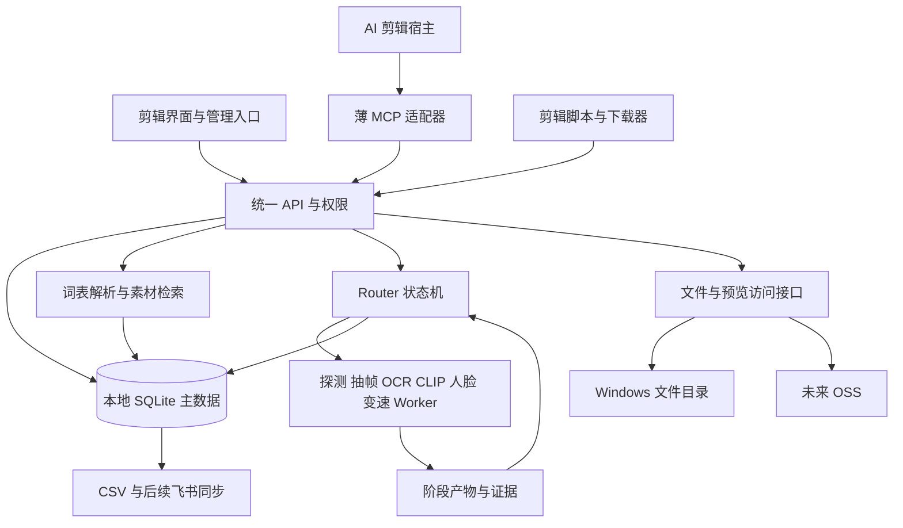

# 素材库设计总览

整理日期：2026-11-07。状态：设计基线，D00～D04及D09～D11工程已验收，见 [D00说明](contracts.md)、[D01说明](catalog-storage.md)、[D02说明](media-evidence.md)、[D03说明](router-queue.md)、[D09说明](upload-variants.md)，D17[文件基础](file-access.md)已实现，整项仍实施中。业务边界见 [REQUIREMENTS.md](REQUIREMENTS.md)；HTTP上传/调度、衍生契约及授权文件基础已实现，[D04模型Worker](model-workers.md)已实现并完成本机推理验证；[D10人脸打码](face-redaction.md)已实现核心/接口与本机验证；[D11固定变速/组合](fixed-retime.md)已实现；完整语义检索和部署仍未实现，不能把设计图视为运行事实。

## 设计决策

| 决策 | 当前结论 | 状态 |
| --- | --- | --- |
| 人员界面 | 极简、画廊默认、列表可切换；视频处理独立；标签后台运行 | 用户已选定 |
| 术语解析 | 已发布词表＋文本小模型；多义、关系和否定独立处理 | 用户已选定路线；具体模型待实测 |
| 权威数据 | 单服务写入本地 SQLite，网页、Worker、导出共用契约；数据库不放 SMB 共享盘 | D01核心与D03调度/结果事务入口已实现；常驻部署仍待D07/Q01 |
| 团队部署 | 常开 Windows 承载 API、任务状态、数据库和文件服务；开发机仅做开发/测试 | 当前推荐，取代早期开发机长期承载主库的团队部署建议；Q01/Q02 |
| 存储访问 | Filesystem 首期，OSS 后续；稳定入口和对象映射隔离物理路径 | D01本地后端与统一接口已实现；OSS明确未配置，真接入留D08 |
| AI 接入 | HTTP API 为公共能力，MCP 为薄适配层，剪辑端负责下载和当前用途检查 | 推荐方案，Q04/Q05 |
| 模型运行 | 确定性工具＋专用小模型；可选 VLM；GPU 重任务全局串行 | D04本机CPU/CUDA实测及队列适配已实现；正式词表/代表性校准、最终主机与可选VLM仍待后续 |
| 人工管理 | 词表、医学标签审核、来源修订和导出放管理入口 | 为满足现有规则拟定；角色由 Q03 指定 |

## 总体结构

Router 是确定性调度程序，负责依赖、租约、幂等、取消及资源配额；Worker 是执行固定职责的进程。“开发时分派任务的 Router/Worker”和系统运行时进程分开记录。普通查询不需要启动一条视觉分析流水线，下载也不依赖模型可用。

## 模块与职责

| 模块 | 负责 | 不承担 |
| --- | --- | --- |
| 素材登记 | 上传完成校验、去重、来源记录、身份与版本 | 不因同字节合并许可或账号可见范围 |
| 文件服务 | 授权访问、Range、固定哈希下载、预览描述、后端切换 | 不暴露任意盘符/路径或永久签名链接 |
| 后台分析 | 技术事实、抽帧/OCR/模型建议及证据 | 不确认医学结论、许可或人工身份 |
| 视频处理 | 完整片段人脸轨迹、遮罩、速度/音频、输出校验 | 不用稀疏抽帧检测冒充完整打码 |
| 词表服务 | 概念/别名审核、不可变发布、上下文解析、文本候选召回 | 不把相关关系变同义、不自动新增锁定分类 |
| 素材检索 | 有权限候选、匹配理由、实际版本与片段时间 | 不把 AI 建议当有效医学标签，不替代看片 |
| 管理审核 | 逐字段采用、冲突处理、输出复核、词表发布 | 各审核状态互不替代 |
| AI 接入 | 统一查询/详情/预览/下载清单；剪辑任务内取得实际文件 | 不改相邻项目共享素材、旧任务或最终导出策略 |
| 导出同步 | 一致快照 CSV；后续飞书差异同步/冲突处理 | 不直接把飞书或 CSV 变成另一个无规则主库 |

## 三条业务链路

1. 素材库上传：上传完整性校验 → 原件登记 → 自动派发探测/分析 → 标签建议 → 人工修订 → 索引/表格。原件和候选的可见范围由权限决定，未知状态不得写成“没有”。
2. 独立视频处理：直接上传或选择库内有权版本 → 选择打码/变速 → 处理输出 → 连续预览与复核 → 下载或主动加入素材库 → 后台更新属性/标签。技术探测是处理前提，语义打标成功不是。
3. AI 取材：镜头需求 → 口语/专业词检索 → 看候选实际预览 → 选择固定 asset_id/hash/片段 → 剪辑端下载校验 → 当前用途检查 → 加入本次剪辑。查到、可下载、适用、已医学审核是不同结论。

人员主导航拟定为“素材库、视频处理、我的任务”，管理入口按权限显示。术语补充在搜索旁轻量提交，管理端独立审核/试搜/发布，详细交互保留在术语专题第 9 节。

## 数据与时间约定

- 每个可下载素材版本拥有自己的 asset_id、不可变文件哈希；root_asset_id 将原件和衍生版本归为一组，parent_asset_id 表示直接来源。metadata revision 表示该版本记录的修订，不表示可以替换该 ID 对应的文件字节。
- blob 保存内容身份；source 保存来源、许可、旧 ID 和原话；storage_location 保存实际后端。相同 blob 可有多个来源，不自动合并授权。
- tag_suggestion 与 effective_tag 分开；人工字段修订带身份、证据与版本。taxonomy 限定正式标签值，lexicon 负责口语映射，两者分别发布。
- 处理配方保存源哈希、速度、音频策略、轨迹修订、软件/模型版本、输出哈希和 time_map。片段时间绑定实际文件版本；默认 1.0 倍，变更配方从登记的基准生成，不隐式叠加倍速。
- 任务、尝试、租约、错误、报告由服务端维护；任务目录保存阶段产物。默认最多 3 次总尝试（含首次），旧租约结果不得发布；成功阶段按输入及版本指纹复用。
- 表格保持原始素材表 35 列、缺口表 14 列。模板不能表达的未知/混合/运行状态留在内部质量报告，不擅改表头或塞假值。

## 技术选型与资源约束

Python、FastAPI、SQLite、FFmpeg/ffprobe 为当前工程方向；D00已落地Python 3.12、Pydantic结构校验、setuptools及pytest，实际版本/哈希见依赖锁。前端拟定服务端HTML/CSS＋原生JavaScript，轨迹修订使用浏览器canvas，D00不建立占位网页或Node工具链。服务和前端均尚未实现；未来引入框架时先记录需求与影响。各接口先定 JSON Schema/错误/权限契约，不先搭多个框架或服务。

OCR、YuNet、Chinese-CLIP 和 BGE-small 是现有方案候选，具体版本在独立环境实测后锁定；VLM 为后置选项。32GB 内存和 8GB 显存不能据此认定任何模型组合已兼容。GPU 重推理/硬件编码共用配额，不能按不同队列各自占满显存；搜索和文件服务保持可响应。

开发阶段可本机测试契约；团队首期需要 Windows 真机和局域网下载闭环。stdio 桥接或远程 Streamable HTTP MCP 以目标宿主实际能力选择。云端 AI 要另解决内网可达性；文件迁往 OSS 不等于检索 API 自动公网可达。

## 发布与数据边界

生产数据/表格/模板不进 Git，代码与合成夹具进入版本控制。下载接口先校验身份和对象权限，失效/撤回不静默换成另一版；输出失败不损坏上次有效结果。打码预览、缩略图必须来自正确输出，不能泄露原脸。

部署使用受控账号、可恢复的数据库及对象备份；真实恢复演练属于首期验收。飞书和 OSS 首期定义适配边界，真实接入待后续配置与授权。任何外部写入、跨项目规则改变均按已授权范围处理，不因设计中列出就视作已经执行。

## 专题设计与验收依据

- [存储、字段归属、A01～A11 验收及 AI 接入](DESIGN_AND_IMPLEMENTATION.md)：第 4～6、10、12 节。
- [模型、任务协议与 D00～D08](MODEL_ROUTER_WORKER_PLAN.md)：模型候选、租约、重试、资源和产物协议。
- [上传、人脸与变速 D09～D12](UPLOAD_AND_MEDIA_VARIANTS.md)：完整视频处理和版本关系。
- [词表与小模型 D13～D16](TERMINOLOGY_MAPPING_PLAN.md)：发布契约、交互及 T01～T12/业务评测。

总控文档确定范围、设计状态和实施顺序；专题保留字段与算法细节；冲突先检查本轮明确修订，不把旧阶段排期重新当作当前主线。
