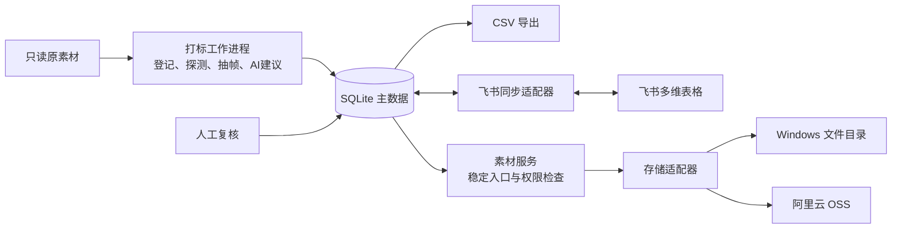
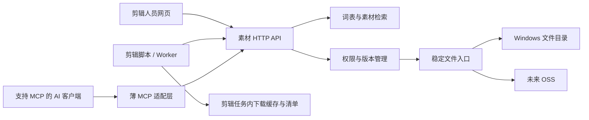

# 素材打标项目：设计与实施方案

初稿日期：2026-11-06；归并日期：2026-11-07。状态：专题设计与验收提案，尚未部署或实现。范围、设计状态、当前顺序和进度分别以 [需求基线](REQUIREMENTS.md)、[设计总览](ARCHITECTURE.md)、[实施计划](IMPLEMENTATION_PLAN.md)、[进度记录](PROGRESS.md) 为入口；本文保留存储/契约/验收/AI接入细节。

界面方向已选定：极简素材库默认画廊、可切换列表，打码/变速作为独立视频处理功能，AI 打标后台自动执行。具体交互、任务调度和更新后的 D12 验收见 [上传与处理方案](UPLOAD_AND_MEDIA_VARIANTS.md)。人工医学审核不因后台自动运行而取消。

术语对应已选定“词表＋小模型”路线，具体契约、检索策略及 D13～D16 任务见 [术语对应实施方案](TERMINOLOGY_MAPPING_PLAN.md)。该项选择不代表其余部署方案已批准。

后续细化见 [小模型与 Router/Worker 实施方案](MODEL_ROUTER_WORKER_PLAN.md)：用户已提供 i5-14400F / 32GB / RTX 5060 8GB，优先建议 Windows 本地推理；该文包含可下发任务卡，部署仍待选定。用户模板目录现已改为仅本地保留、忽略 Git，早期历史副本保留。

## 1. 建议与本次初始化范围

建议团队首期采用 **Windows 文件与 API 服务 + 本地打标 Worker + 同主机本地磁盘 SQLite + CSV 导出**，再接飞书多维表格，最后按需要迁移文件到 OSS。开发机可以先运行契约测试，但不作为团队常驻主库的默认宿主。采用单服务、模块化实现，不在第一期引入多服务集群、向量数据库或自建对象存储集群；实际部署仍待选定。

本次已建立 Git main 分支、README、AGENTS、忽略规则与本方案；保留原始模板。未安装运行依赖、未连接 Windows、未复制原素材、未调用模型批量打标、未写飞书、未修改 doctor-video-automation。

参考 doctor-video-automation 的 AGENTS.md 与 docs/ROUTER_WORKER_DESIGN.md：沿用模板与任务分离、原文件只读、版本绑定、可续跑、实际校验和可追溯记录。剪辑/包装流程及其历史授权不复制到本项目。

## 2. 目标与假设

- 输入：图片、视频、GIF、贴纸、音效、BGM、文献截图。
- 输出：保留现有素材表 35 列、缺口表 14 列的表格；内部数据另存工程字段，不向表头塞入运行状态。
- 初期假设：少量协作者、一个主写入进程、Windows 常开且有稳定内网。实际素材量、容量、Windows 版本、备份盘与外网使用需求尚未核实。
- 模板中提到的 259 条 footage 是原方案背景，尚未核实为本项目当前库存。
- “飞书文档”按所给模板理解为飞书**多维表格**。若最终使用普通电子表格或 Docx 文档，应调整输出适配器；附件、关联和人员语义不能直接照搬。

## 3. 整体结构



推荐实现栈：Python + FFmpeg/ffprobe + SQLite，文件与索引 API 用 FastAPI；轻量网页已属首期人员工作流，框架由 D00 选定。此为技术建议，不代表已创建工程或锁定依赖版本。

团队首期推荐由常开 Windows 承载 API、唯一写入进程、数据库、文件服务和按配额运行的 Worker；开发阶段可先在开发机做契约与合成数据检查。稳定下载入口按 asset_id 和权限访问对象映射，不依赖临时开发电脑在线。

远程 Worker 通过 API 领任务、交结果。**不让多台电脑通过 SMB 直接打开同一个 SQLite 文件。** 确有高并发写入需求时再评估 PostgreSQL。数据库迁移和文件后端迁移分别处理。

## 4. Windows 文件服务器如何建立

### 路线比较

| 路线 | 适用 | 成本与限制 | 建议 |
| --- | --- | --- | --- |
| 只有 SMB 共享 | 单人试验、手动浏览 | 配置最少；表格网页下载体验差，路径依赖系统 | 仅作临时验证 |
| Windows 目录 + 素材 HTTP 服务，SMB 辅助 | 内网团队、后续迁移 OSS | 需维护一个轻量服务；可用统一入口隔离物理存储 | 推荐 |
| Windows 上先部署对象存储服务 | 已有对象存储运维经验 | 多一层服务、升级和备份；仍需验证 OSS 差异 | 当前无必要 |
| 直接 OSS | 远程协作优先 | 需要云账号、上行带宽与持续存储/请求/下行费用 | 外网需求强时选择 |

### 推荐落地步骤（选定后实施）

1. 盘点 Windows 版本、磁盘可用空间、现有数据、网络和管理员权限。固定 DHCP 租约或内网 IP，建立内部 DNS 名称；设定常开与服务故障重启。
2. 独立数据盘建立下列目录。库容量按“原件 + 预览/代理 + 导入暂存峰值 + 备份”实测估算，不用素材条数推算容量。

```text
D:\MediaLibrary\
  incoming\       人工投递区，导入前暂存
  objects\        正式原件，按哈希分层，不按科室移动
  derivatives\    缩略图、抽帧、预览代理
  manifests\      已发布的 asset_id 到对象的映射快照
  service-data\   服务状态与本地数据库，不通过SMB共享数据库文件
```

3. 单独服务账户读写对象库；剪辑师只读正式库、可写投递区，管理员独立。SMB 共享权限与 NTFS 权限同时配置；无匿名共享。只向内网/VPN 开放必要端口，SMB 不映射公网。
4. Windows 原生运行轻量 HTTP 服务，作为系统服务自动启动；前置 HTTPS 入口，证书需受客户端信任。支持登录、权限检查、Range 视频预览、下载文件名与访问日志。具体服务托管方式在核实系统版本后确定，无需先强制上 Docker/WSL。
5. 服务只按登记的 asset_id 查映射，不能接收任意磁盘路径；临时上传写暂存文件，完成大小及哈希校验后原子发布。首次只复制、不移动原件。
6. 备份到另一块物理设备或后续云端：原件增量备份，数据库用一致性快照，映射清单/词表/配置同步备份，凭证单独保管。试运行建议每日备份，每月做一次恢复演练；目标 RPO 24 小时、RTO 一个工作日，需由实际业务决定。磁盘镜像不能替代备份。

Windows 支持局域网文件共享；具体账户与共享设置以 [Microsoft 文件共享说明](https://support.microsoft.com/en-us/windows/experience/connectivity-networking/file-sharing-over-a-network-in-windows) 为依据。网络边界参考 [Microsoft SMB 安全指南](https://learn.microsoft.com/windows-server/storage/file-server/smb-secure-traffic)。上述目录和服务组合是本项目建议。

### 内网与飞书的关系

飞书里的下载链接由使用者的电脑打开：电脑在内网或接入 VPN 时才能访问内网服务，离开内网就无法下载。飞书不会把内网服务器自动变成公网文件服务。

飞书“预览”附件由内网同步进程主动上传小缩略图到飞书，再把 file_token 写入记录；不能把 `D:\...` 或 SMB 地址当作附件。只上传预览不等于原文件已上云。飞书支持先上传素材、再用 file_token 写附件字段，见 [多维表格 API FAQ](https://open.feishu.cn/document/docs/bitable-v1/faq?lang=zh-CN)。

若要在外网访问原件，选择 VPN 或提前使用 OSS。是否允许素材/预览交给云端模型与飞书，在选模型及接入时确认实际数据范围，不默认为所有原件可上传。

## 5. 随时切换到 OSS 的设计

### 身份与存储分离

| 概念 | 拟定表达 | 迁移是否改变 |
| --- | --- | --- |
| 素材身份 | 内部不可变 UUID；展示 ID 沿用 M0070 等，冲突时保留命名空间与别名 | 不改变 |
| 内容身份 | 原件 SHA256 | 字节不变则不改变 |
| 对象键 | `originals/ab/<sha256>.mp4` | 两种后端保持相同 |
| 物理位置 | provider、root/bucket、object_key、verified_at | 可新增/切换 |
| 下载入口 | 拟定 `https://<受控域名>/v1/assets/<id>/content`，D17冻结 | 保持域名和路由稳定 |
| 本地路径 | 已登记来源库根目录下的相对路径 | 仅作历史来源，不作为下载依据 |

“本地路径”继续保留模板的相对路径语义，内部另记 source_repository/source_root。不能把 Windows 盘符或 OSS key 偷换进该列；没有可靠来源路径时留空。

设计存储接口：`put / stat / open_range / create_download_url / copy / verify`。Filesystem 与 OSS 各自实现；业务层不拼 SMB 或 OSS URL。对象不可变；修改素材生成新哈希、新版本和衍生关系。缩略图键同时包含原件哈希与生成规则版本。

下载入口先认证：Windows 后端流式读取文件，OSS 后端生成短期签名地址并重定向。表格永远保存入口地址。OSS 私有对象签名 URL 有有效期，因此不适合作为永久索引地址，见 [OSS 签名下载说明](https://www.alibabacloud.com/help/en/oss/user-guide/how-to-obtain-the-url-of-a-single-object-or-the-urls-of-multiple-objects)。

**文件切到 OSS 不等于入口自动公网可用。** 若希望外网使用，同时将轻量下载网关部署到可访问主机并迁移 DNS/认证配置；OSS 负责对象文件，网关继续负责稳定入口。

### 迁移过程

1. 生成迁移清单：素材 ID、对象键、大小、SHA256、源位置、目标位置与状态，新增文件进入增量队列。
2. 复制到私有 OSS Bucket，使用断点续传与可重试任务。大文件策略参考 [OSS 上传方式](https://www.alibabacloud.com/help/en/oss/user-guide/upload-objects-to-oss/)。
3. 每个对象校验大小及实际读取内容的 SHA256；保存校验记录，不能以文件名、上传成功或 ETag 替代 SHA256。重读会有时间和流量成本，试点时测量。
4. 只给已校验对象新增可读位置，再逐批切换优先后端；新增写入切换前处理完旧队列并做最终增量核对。
5. 旧库保持只读作为回退。OSS 不可用时仅对旧库仍有的已校验副本回退；切换后新入库对象若要求可回退，也必须反向复制并校验。
6. 验证素材数量、哈希、实际下载、Range 预览和飞书入口后再结束迁移。旧文件保留期建议至少 30 天，删除另行决定。

“随时切换”指接口和身份预先解耦，不代表 TB 级文件能瞬间传完。先复制校验，再切路由，可逐个对象迁移，标签无需重打。

## 6. 数据模型与表格契约

SQLite 是主数据，CSV 是导出快照；飞书接入后是协作编辑界面，按字段归属同步。不能让 CSV 和飞书同时无规则地充当主库。

建议内部实体：assets（每个可下载文件版本的稳定 ID 与元数据修订）、blobs（哈希/大小）、asset_sources（来源/旧路径/别名）、storage_locations（多后端位置）、derivatives、tag_suggestions、effective_tags、field_revisions、review_events、jobs/stages、sync_outbox、feishu_mapping、gaps。原件及衍生版本用 root_asset_id 归组、parent_asset_id 追溯，不在同一 asset_id 下静默替换文件字节。

同字节文件复用一个 blob，来源记录分别保留；许可和来源不同不能因哈希相同而自动合并掉。原有多个素材 ID 可通过别名关联，存在来源冲突时进入复核。飞书同步以内部稳定 ID 对应 record_id，SHA256 作内容校验与重复检测，不作为唯一业务身份。

### 字段归属

| 类别 | 字段与处理 |
| --- | --- |
| 脚本控制 | ID、SHA256、路径、下载入口、预览、方向、分辨率、时长、透明底、有原声、曾用任务/原话、入库日期。来源导入的原话/任务必须有依据 |
| AI 建议、人工可修订 | 类型、用途、主体、表现形式、检索词、文字/标注、人脸、片段、情绪；人工改过的值不被后续 AI 覆盖 |
| AI 建议、人工逐条确认 | 科室、器官/系统、疾病/症状、过程/状态 |
| 人工控制 | 来源、页面、许可、署名、医学备注、不适用场景、标签状态、打标人。新行可由系统初始化“AI初稿”“未核实”，不得自动晋升“已人工确认” |

飞书接入后人工字段以飞书为准，本地保存副本和修订历史；接入前通过本地复核入口写入。切换编辑入口时完成一次基线对齐，避免两个地方同时编辑。同一行的“已人工确认”须绑定素材版本、相关有效标签和审核记录；内容变化后标记需复核，旧审核历史保留。

### 模板中待补齐的问题（原文件暂不改）

- 科室含“…”、器官只有示例、疾病列表未给出：先提取有依据的种子候选，由管理人发布词表 v1；模型建议新词进入候选清单，不能当已锁定选项。
- “带文字/标注”只含无/英文/中文：中英混合、其他语言无法准确表达；建议增补混合/其他/待确认，需选定后改字段契约。
- 音频没有方向/分辨率，图片没有时长；这些值留空。内部 true/false/unknown 三态不能把“未检测”导出为 false；飞书复选框无法表达 unknown 时放入单独的质量报告，未检测完成项不当作技术字段完整。
- 含 alpha 通道不一定实际透明；有音轨不一定有可听声音。需分别检测实际透明像素与音频内容，区分容器信息和语义标签。
- 人员字段需要真实飞书用户 ID；AI 不能填写虚构员工。缺口表“提出人填 AI”与人员类型不兼容，建议人员留空、内部记录 actor_type=ai，或后续明确改字段类型。
- 标签状态在文字说明中有空格、CSV 枚举为“AI初稿”；导出以 CSV 值为准，导入时做明确规范化映射。
- CSV 无法携带飞书附件、人员与关联的真实对象类型：CSV 先供查阅/导入，后续 API 才写附件 token、用户 ID、关联 record_id。缺口关联素材用已保存的 ID 映射解决。

## 7. 打标流水线与复核

拟定阶段：扫描 → 稳定文件检查 → SHA256/重复检查 → 技术探测 → 预览/抽帧 → AI 建议 → 契约校验 → 人工复核 → 索引发布与表格导出。

每步记录输入哈希、规则/词表/模型版本、结果文件、耗时、失败类型；任务失败只重试对应阶段，默认最多 3 次总尝试（含首次），鉴权/输入错误直接等待处理。中断可恢复，同一批次重跑不重复建行。应用标签使用版本条件，防止覆盖期间的人工修改。

- 图片看实际原图，OCR 记录画面文字；文献截图只描述可见内容，不凭截图补造论文结论。
- 视频先首/中/尾抽帧作内容概览，对变化过程、动作和可用片段再增加时序采样并看连续短片；仅 3 帧不足以确认“肿胀→消肿”。混合内容按区间留证据。
- GIF 检查完整周期；音效/BGM 需实际音频分析或试听，不拿静帧打语义标签。
- 每个建议保留图片/帧时间/片段依据和模型版本；模型自报置信度只辅助排序，不等同准确率。
- 无法判定的主题和方向留空或待复核，技术状态放内部字段，保持外部标签状态两项不乱扩。
- AI 初稿可导出供查找，但与“已人工确认”明确区分。医学关键字段未确认，不自动将整行标为确认。

试点选 30 条，覆盖不同素材类型、医学科室、正反变化方向、带字、重复文件、音频、损坏文件。逐条人工核对；统计字段准确率、未判定率、方向错误、耗时和模型费用。方向错误必须修正且验证后，才扩大到全量。全量时先跑技术信息，再按批次跑语义分析，支持预算上限和暂停。

## 8. 飞书同步方案

第一步单向推送新素材和脚本字段；第二步接入人工字段回流。按 table_id/field_id/record_id 保存映射，不依赖字段显示顺序或行号；字段名改动时检测 schema 差异。

写入走持久 outbox：稳定素材 ID、操作 ID、目标字段、基线值与预期新值。请求超时先查远端并对账，再决定重试，避免“新增成功但响应丢失”造成重复行；记录逐条成功/失败，不把整个批次直接视作成功。

按字段做三方比较：上次同步值、本地值、远端值。只有一方变更按字段归属处理；双方变更且不一致进入冲突报告，不按最后时间覆盖。人工修改保留修订记录。第一期不自动传播删除；远端删行标为缺失等待处理，删除素材采用软删除，不连带物理删除原件。

同步写前生成差异清单，试点授权后可定期自动同步已选字段。附件上传失败只重试附件，不重复新建整行。多选传数组、数字传数字、超链接/人员/附件/关联按实际 API 类型编码，不能直接把 CSV 字符串原样发送。

API 权限、限额、批量大小和租户可用功能在接入时查当前官方文档并做小批实测，不将今天的限额写死。预览、同步日志及密钥不混放；使用最小所需应用权限。

## 9. 拟定工程组织

```text
asset-index-template/   用户原始模板与规则，现有
docs/                   方案、部署手册、迁移及验收，现有
config/                 后续：无密钥配置示例、字段映射schema与合成示例
src/media_tag/          后续：catalog、pipeline、storage、tagging、export、sync
scripts/                后续：命令入口，复用 src 内公共逻辑
tests/                  后续：去重、契约、人工值保护、同步与存储切换测试
jobs/<job_id>/          运行时：manifest、分阶段证据、review、report
data/ cache/ outputs/   运行时：数据库、缓存、导出快照；Git 忽略
```

拟定命令职责为scan、probe、tag、review、export、sync、migrate-storage；当前已实现serve/work-once及D06字段复核/CSV的HTTP与人员页，没有上述同名review/export CLI。CSV 采用 UTF-8 BOM，表头顺序严格跟随模板；对外部文件名等字段做电子表格公式注入防护，内部原值保留。写出使用临时文件与原子替换，同时输出快照版本和数据校验报告。

## 10. 分阶段实施与验收

下表P0～P5保留为早期专题交付分组和验收引用，不再作为完整项目实施顺序；当前主线为 [实施计划](IMPLEMENTATION_PLAN.md) M0～M6，已包括独立视频处理、术语维护和AI取材。

| 阶段 | 交付 | 验收标准 |
| --- | --- | --- |
| P0 方案确认 | 存储路线、部署位置、表格形态、词表归属 | 本文关键决策明确 |
| P1 本地闭环 | 字段契约、SQLite、扫描探测、文件适配器、CSV 导出 | 两张表头逐列一致；重复扫描不重复建行；中断恢复；原件哈希不变；异常文件可定位 |
| P2 AI 与复核 | 模型适配器、证据记录、30 条试点、人工修订 | 逐字段有依据；变化方向逐条核对；重跑保护人工值；费用和失败率实测 |
| P3 Windows 服务 | 下载入口、登录、对象映射发布、备份恢复 | Mac/Windows 真机可下载与拖动视频预览；未授权拒绝；断线可恢复；备份可还原 |
| P4 飞书 | 字段映射、预览上传、增量推送、人工回流 | 新增超时重试无重复；人工编辑不丢；冲突可见；缺口关联正确 |
| P5 OSS 演练 | OSS 适配器、复制校验、分批切换与回退 | 同一个入口切换后字节一致；ID/标签不变；未迁移和新入库对象均按策略可读 |

P1/P2 可用少量本地文件先跑，不必等待服务器部署；P3 用于团队使用。P1 就定义双后端接口，P5 再连接真实 OSS 验收。开发工期与费用需在机器、素材样本、模型路径确认后估算，不沿用旧方案“全量 1～2 天”的承诺。

必要测试覆盖：哈希重复而来源不同、同名不同内容、中文长路径、损坏媒体、音频空技术字段、生成阶段断电、人工修订后 AI 重跑、飞书新增响应丢失、双方并发修改、迁移中断及切换后新对象回退。检查通过与人工标签确认分别记录。

### 10.1 当前首期的验收门槛（拟定，尚未执行）

首期整体验收包含素材库、独立视频处理、后台打标、术语维护与 CSV；飞书和真实 OSS 切换在接入阶段另验。界面草图、模拟 Worker、单元测试、真实模型推理、Windows 部署、人工内容审核必须分别记录，不能互相替代。

验收分三类：工程硬规则全部通过；AI/检索质量达到冻结数据集的业务指标；响应速度与人工操作时间达到约定负载下的目标。核心失败不能用平均成功率抵消。本文所有新数值均为建议，不是现有性能承诺。

| 验收项 | 必须观察到的结果 | 证据与负责人 |
| --- | --- | --- |
| A01 素材库与界面 | 默认画廊、可切列表且保留查询/筛选/选中版本；可搜索、预览、按权限下载；未知与失败状态明确 | 页面操作记录＋实际文件/接口响应；D12/D15，剪辑试用 |
| A02 上传与后台打标 | 上传登记后自动排任务，无需点击打标；重复上传复用文件但保留来源；分析失败不阻塞独立处理与授权下载 | 上传哈希、任务/数据库状态、失败注入记录；D01/D03/D09/D12 |
| A03 独立处理 | 可直接上传或选库内有权视频，单独打码、单独变速、两者组合均跑通；结果下载与加入素材库分别操作，重复入库不新增重复版本 | 三条真实视频闭环及版本记录；D09～D12 |
| A04 人脸处理 | 对冻结测试集所有目标人脸连续检查，无已发现漏打码、遮罩明显滞后或切镜串框；可补框后重渲染；修改配方/输出使旧复核失效，复核绑定实际哈希 | 全片人工复查＋风险区间逐帧证据；D10/D12、指定复核人 |
| A05 变速与音频 | 输出可完整解码，速度/音频策略正确，遮罩同步；重复请求不叠加倍速；每个输出源关系、实际时长和哈希可查 | 探测、时间标记测量及试听；D11/D12 |
| A06 标签质量 | 普通可自动填写字段的非空建议人工接受率拟定≥90%，同时报告字段覆盖率与多选 precision/recall；医学字段只产建议，逐条确认 | 独立样本的建议、画面证据、实际人工判定；D04/D06/D07。各字段覆盖门槛须在试点前冻结，未冻结则业务验收未完成 |
| A07 词表与检索 | T01～T12 全过，独立评测的准确率/覆盖率/检索门槛通过，种子数据不自动发布 | 详见术语方案第 10 节；D13～D16 |
| A08 故障与恢复 | Worker 终止/服务重启/重复回调/旧租约返回均可处理；无重复发布；只重试相关阶段；旧 GPU 未释放不派替代重任务 | 故障时间线、任务尝试/租约、资源记录；D03/D07 |
| A09 导出与原件保护 | 表头和列序严格跟本地模板，内部字段不擅加列；失败保留上次导出；原件前后哈希相同；AI 重跑不覆盖人工值 | 表头校验、修订前后快照、哈希清单；D00/D01/D06 |
| A10 权限与备份 | 无权账号无法获取私有原件/未复核输出或发布词表；授权操作者可查看复核预览，但未复核输出不作为团队已处理副本发布；下载失败不回退原件；隔离环境备份还原保持文件关联、标签和版本关系 | 跨账号/API/预览/下载检查及真实还原记录；D01/D07/D12/D13 |
| A11 AI 剪辑接入 | API/MCP 检索结果一致；取回固定素材版本并核验哈希；片段时间基于实际下载版本；在剪辑任务内完成当前用途检查后才能采用；网络/权限/模型错误不伪装无素材 | 第 12 节 I01～I08；D17～D20，并入 D07 |

人脸处理至少准备 12 条不同源视频，整体覆盖多人交叉、侧脸/转头、遮挡重现、出入画、快速运动、切镜、竖屏旋转及小脸等条件。标明应处理的人脸与用户显式排除轨迹。先记录自动输出漏打码区间及人工修正用时，再验收修正后的完整输出，不能以最终人工修正掩盖自动质量。自动质量和修正耗时门槛在校准阶段冻结；未达标不开放无人复核使用。测试集未发现漏码不是对所有视频的保证，每个实际打码输出仍需复核。

变速至少覆盖 0.5/1/1.25/2 倍及所开放范围边界、无音频、多音轨选择、可变帧率、音画起点偏移和打码组合。使用已知时间/声画标记的样本：拟定时长误差≤max(两个输出帧时长, 0.1 秒)，恒帧率按 2/F 计算，可变帧率按末端实际时间间隔检查；输出前/中/后声画标记相对预期映射的偏移误差拟定≤80毫秒。它们是本项目拟定技术容差，不是行业或医学标准。原本没有声音/同步标记的素材不能伪报同步通过，另验对应纯视频分支。

### 10.2 验收组织、记录和发布判定

1. 开工前固定样本清单/哈希、支持格式/上限、词表与分类版本、目标机器、并发人数、质量/性能门槛；样本内容和报告置于 Git 忽略目录。先用 30 条跑通链路，再按模型方案扩充独立素材集；术语独立集按术语方案执行。
2. 每张 Router/Worker 任务卡附对应 A/T 用例 ID、输入、操作、预期和证据要求。Worker 自验提交真实产物；Router/集成者复查跨模块链路；实际剪辑验操作体验，指定内容审核人验术语/医学建议和打码输出。自动代理不替人签确认。
3. 拟定记录字段：用例 ID、代码/规则/模型版本、环境、样本哈希、前提、步骤、预期、实际、证据路径、执行者/复核者、执行时间、结论、缺陷号。结论区分“未执行 / 通过 / 失败 / 阻塞 / 不适用”；不适用需说明支持范围，未执行或缺真实环境不能计通过。
4. 原件损坏、越权访问、未审核映射发布、人工值被覆盖、漏码输出被宣告已复核等为阻断问题，修复并回归前不发布相关能力。普通任务流程失败也阻止该能力验收。轻微视觉问题可列明确剩余项，但不能把影响核心操作的问题降为外观问题。
5. 通过需：首期核心用例全部通过、业务/性能门槛满足、真实环境验证完成、未决阻断项为 0、验收记录可追溯。若某能力未通过，报告其限制与禁用范围，只有用户接受缩小范围后才能按缩小后的版本交付；不得将“部分可用”写成“整体验收通过”。

当前项目仍只有方案和草图；尚无真实 Windows、模型、视频输出或业务准确性的验收结果。文档/草图检查通过不改变这一状态。

## 11. 待定事项

统一维护在 [需求基线](REQUIREMENTS.md) Q01～Q07：部署、环境/容量、审核角色、AI宿主、跨项目来源规则、飞书/OSS目标和验收门槛。每项有最迟确定阶段；后续云接入信息不阻塞当前本地契约开发。无需在聊天中提供密码或AccessKey。

## 12. AI 剪辑如何检索与取得素材（拟定）

用户新增核心目标：素材库除供剪辑人员使用，也要供 AI 剪辑项目查找、检查和取得素材。建议采用 **统一素材 HTTP API＋薄 MCP 适配层＋剪辑端下载适配器**。当前只是设计，以下接口、工具名和任务卡均尚未实现；没有配置 MCP 客户端、连接 Windows 或修改相邻项目。

### 12.1 结构与选择理由



- HTTP API 是网页、脚本、MCP 的公共契约；MCP 只把能力包装为模型可发现/调用的工具，不能另做一套检索、权限、数据库或标签逻辑。初期可共用同一个服务部署，不要求拆微服务。
- 当前 Python 剪辑 Worker 可直接调用 HTTP API，接入无需先改造整个 Router 为 MCP 客户端。支持 MCP 的 AI 宿主可用相同能力自主选工具；不支持 MCP 时由宿主把 API 包装成自己的工具函数。
- 文件下载走受保护的文件入口，模型上下文只接收少量候选元数据及按需预览。首期不把完整视频以 Base64 放进工具结果，不让 AI 扫共享盘、读取 SQLite 或从导出表格猜文件位置。
- 存储从 Windows 切到 OSS 时，只改存储适配器和对象映射。素材 ID、检索契约和调用方工作流保持稳定；飞书是索引输出，不作为 AI 取材的运行依赖。

### 12.2 现有剪辑项目的接入点与边界

只读检查相邻 `doctor-video-automation` 发现：

1. `skills/medical-media-search/scripts/media_search.py` 已做本地盘点/词项检索；`media_library.py` 已做 SQLite 本地库查询、SHA256 校验及来源合并。可新增 `media-tag` 来源适配器接公共服务，不必重做整条剪辑链。
2. `media_library.py` 的公网下载器限定核实域名的 HTTPS 并拒绝内网地址。不能把 Windows URL 塞进它，也不能放宽其全部地址限制；另建仅连接配置中受信素材服务的下载器，保持公网来源保护。
3. `scripts/prepare_media.py` 对来源、清单、格式和任务路径有明确校验。新增来源要显式接入契约，不能把素材库假扮成 `local-licensed`、Servier 或已获得商用许可的来源。库服务地址与原始来源页面分别记录。
4. `docs/PREVIEW_ONLY_WORKFLOW.md` 当前要求实际看图/看片并做当前用途检查，再自动登记应用，流程止于完整预览，医学状态仍 pending。库内标签确认不替代这次检查；新适配器不得打开正式导出或伪造当前用途验收。
5. 相邻项目现有新视觉素材检索规则仍是百度优先。建议后续将已登记内部素材复用设为优先、库内无合适素材时再按原外部来源规则补查；这是待确认的流程调整，本轮不改相邻配置、规则或旧任务。来源和许可策略沿各项目实际授权执行，不自动继承或改变开关，未知仍保留未知。

### 12.3 首期只读工具和 API 契约

业务接口中，D17[授权文件基础](file-access.md)已实现；D17分页语义检索也已实现（[说明](asset-search-api.md)），D18只读MCP适配工程已实现（[说明](mcp-adapter.md)），实际宿主待联调，具体 MCP 协议封装由选定 SDK 负责。Schema 版本化，缺失/无匹配/降级/服务不可达/无权限分别返回；权限主体来自验证后的凭证，不能由模型传一个 user_id 获得权限。

| MCP 工具（拟定） | HTTP 能力（D17公共API已实现） | 输入与返回 |
| --- | --- | --- |
| `search_assets` | `POST /v1/assets/search` | 输入原话、当前镜头意图、用途、素材类型、方向/时长等条件；返回分页候选、命中理由、明确解析/歧义/降级状态及版本 |
| `get_asset` | `GET /v1/assets/{asset_id}` | 返回指定可下载版本的技术信息、标签有效值/AI建议、证据区间、来源、许可、隐私复核及同组可见版本 |
| `get_asset_preview` | `GET /v1/assets/{asset_id}/preview-manifest` | 输入固定文件哈希及可选片段；返回有权限的缩略图/代理资源描述、代理自身哈希与源时间映射。受支持宿主可按需读取小图；资源地址本身不代表模型已看过 |
| `get_asset_download` | `GET /v1/assets/{asset_id}/download-manifest` | 返回绑定固定版本、预期 SHA256、字节数、实际格式和稳定下载入口的清单；由剪辑端下载器取得字节并校验 |

下载字节使用单独的 `GET /v1/assets/{asset_id}/content`，携带实际身份及预期版本/哈希条件，支持视频预览 Range 和下载断点恢复。返回的是该版本完整文件，时间区间由剪辑端按记录处理；首期不暗中生成新裁切文件。预览生成若未就绪返回 pending 和查询指引，不能把未生成资源当现成文件。

检索结果默认少量（拟定 10 条，上限 50）、可分页。同组版本折叠排序，但每个候选明确指向一个可下载 asset_id；沿用本项目“衍生版本拥有独立 asset_id”的约定。至少返回：

- 身份：asset_id、root_asset_id、元数据 revision、不可变 blob SHA256；实际下载时再次核验，不只记录一个可变的“最新版本”。
- 适配信息：媒体类型、尺寸、帧率、时长、透明/文字/音频等已知信息及未知项；有硬性格式限制时由服务端过滤，不仅靠模型挑选。
- 片段：开始/结束秒数、所绑定的 asset_id/hash、时间基准，以及动态方向的证据与确认状态。片段为半开区间，边界必须落在实际版本时长内；没有可靠片段时返回空，不编造最佳区间。
- 检索解释：原始查询、采用的专业概念、匹配来自已确认标签还是 AI 建议、相关分数与算法版本。分数不是医学正确概率，相关排序不构成采用批准。
- 使用边界：标签确认、隐私复核、来源/许可状态分别返回；可下载不等于适合当前医学文案。默认优先已确认有效标签，AI 草稿候选必须标识。
- 可追溯性：文件稳定入口、来源记录 ID、真实原始页面、署名信息及词表/分类/搜索版本。未知不补造。

`get_asset_preview` 只能返回该身份有权查看的画面；打码版的缩略图与代理来自打码输出，不能混入原件。代理如重采样/变速须标明时间映射，最终选段仍绑定下载文件的时间基准。远端 MCP 返回的 Windows 路径不是 Mac 上的本地文件；只允许本地下载器在写入完成后报告真实 local_path。

### 12.4 AI 剪辑一次取材的实际链路

1. 剪辑 Router 从分镜产生需求：原句、镜头目的、明确的动态方向、建议时长、尺寸/类型偏好及排除条件。只传当前取材需要的上下文，不上传整份未授权私有文稿。
2. 检索 Worker 调用 search_assets，词表＋小模型在服务内解析口语，候选按可见范围及条件召回。没有匹配、解析歧义、检索降级和网络不可达分别记录。
3. AI 查看少量候选详情与实际预览。需要证明过程时读取连续片段，不能只用文字标签/静帧判定动态方向。宿主不支持对应媒体时，由剪辑工作端下载并通过可用的看图/看片能力检查；无法观看就报告限制，不伪造检查。
4. 选择固定 asset_id/hash 和片段，下载器请求该版本清单并流式写入任务暂存文件；限制大小/格式/目标目录，校验 SHA256、实际媒体格式和解码。完成后原子登记到 `jobs/<job_id>/edit/` 内的专用素材目录；可按哈希复用本任务有效缓存，不写相邻共享 assets。
5. 记录 provider=`media-tag`、库资产 ID、哈希、元数据修订、检索版本、源片段、来源与许可、隐私状态、实际本地路径。若剪辑端再变速/裁剪/打码，登记新变换、输出哈希及时间映射；库内 0.75 倍版本不得误当原速再隐式叠加。
6. 剪辑端按当前工作流对下载的实际文件和本次文案做内容检查，绑定当前素材/文稿哈希和时间，合格后自动采用并生成预览。不把库内“已人工确认标签”写成当前剪辑“已医学审核”。

检索完成到下载期间若版本撤回、权限收回或文件变化，服务端拒绝旧请求并给出重新查询指引，不静默改为原件或新版本。已下载的缓存不因权限撤回而自动消失；客户端在每次采用/新任务复用前重验访问与撤回状态，受限素材服务不可达时不默许继续采用。库升级不能静默替换已完成任务中固定的字节；撤回涉及既有任务时记录影响清单并按项目规则处理。

MCP 工具结果与素材说明是数据，不是可执行指令。下载器只访问配置中的素材服务/明确允许的下载目标，拒绝任意 URL、路径穿越和凭证跨域转发。来源页面仅为出处，不因文本包含链接就自动抓取。

### 12.5 内网 Windows、MCP 传输与未来云端

- 初期脚本：运行剪辑的 Mac/Windows 通过内网 HTTPS 访问常开 Windows 的素材 API；API、权限和文件映射应常驻服务端，不能依赖某台临时开发电脑在线。
- 初期本地 AI 宿主：若支持启动本地 MCP 子进程，可用 stdio 适配器在剪辑电脑运行，再通过 API 访问 Windows。此桥接进程本身不占 GPU，也不承载媒体库副本。
- 需要多个 AI 客户端直接远程连接时，在同服务暴露 Streamable HTTP MCP 入口。具体传输、协议修订和 SDK 版本必须与目标宿主联调并锁定，不能因为“支持 MCP”就假定所有资源展示/鉴权方式均可用。
- 云端执行的 AI/剪辑 Worker 不会因安装 MCP 就获得访问局域网的能力。需要可达的受认证网关/VPN/受控中转，或将执行 Worker 留在内网；迁移文件到 OSS 也不会自动让检索 API 可达。不能为省接入步骤把私有 Windows 共享或 OSS Bucket 开放给公网。
- 初期剪辑服务账户只给 search/read/preview/download 范围，继承对象权限；管理员的词表发布、标签确认、删除等工具不向它开放。stdio 桥接从本地凭证存储取得 API 凭证，不放工具参数或 Git。HTTP MCP 如使用规范授权流程，按官方 Authorization 规范做资源服务与令牌校验；底层 API 使用独立合适受众的凭证/可信内部身份，不盲目透传 MCP token。
- 稳定下载入口不携带长期凭证。优先由网关代理文件；以后优化成 OSS 短签名下载时仅让受信下载器临时解析，日志、表格、MCP 对话和任务清单不保存签名链接。下载重试重新鉴权并固定同一哈希。

### 12.6 Router/Worker 任务卡与验收

以下编号续接 D16，D17公共API工程已实现、真实跨端验收仍待后续，D18适配工程已验证、真实宿主待联调；D19本仓库客户端已实现（[说明](editing-provider.md)），实际宿主登记与D20仍待联调。库侧和剪辑侧分开提交集成，跨项目实现范围在实际下发时明确；本轮未修改相邻项目。

| 任务 | 依赖与拟定范围 | 交付与验收 |
| --- | --- | --- |
| D17 AI 取材 API 与契约 | 契约随D00/D01开始，完整验收需D02/D09/D15；`src/media_tag/api/`、`search/`、对应契约/权限测试 | 分页检索、固定版本详情、预览/下载清单、Range/断点及错误协议；I01/I03/I04/I05 通过；查询方无库写权限 |
| D18 MCP 薄适配器 | D17；`src/media_tag/mcp/`、适配器测试和客户端配置示例 | 4 个只读工具复用 API；先验证一个实际宿主支持的传输，再按需增加第二种；I01/I02/I05/I08 通过，配置不含真实凭证 |
| D19 AI 剪辑来源适配 | D17、剪辑项目实际规则/契约；先在本项目客户端契约测试中验证，随后在剪辑仓库独立维护任务实现 | 明确的 media-tag provider、任务内流式下载/校验/来源登记、当前用途检查衔接；不修改共享素材/旧任务、不伪造批准；I03/I04/I06/I07 通过 |
| D20 Windows—剪辑端联调 | D17～D19、D07部署环境就绪及D16评测；不依赖D07最终签收；`tests/integration/` 和忽略目录真实报告 | 实际 AI 工具检索→预览→下载→哈希检查→任务登记→当前用途检查→完整剪辑预览；失败恢复、撤回、重跑验收；I01～I08 全过 |

实施顺序建议：先与网页同步定义 D17 API 契约 → 脚本直连接口验证下载闭环 → D18 MCP 和 D19 剪辑适配 → D20 真机联调。不会因为先做 MCP 让取材业务依赖具体 AI 客户端，也不会推迟 API 的检索/权限设计到最后。

| 用例 | 验收标准 |
| --- | --- |
| I01 语义一致 | 同一身份、相同输入与索引版本，API 和 MCP 返回相同候选 ID、排序、状态与字段；分页无漏/重复；语义质量沿用术语 T 用例 |
| I02 工具可用 | 实际目标宿主能发现并调用工具、处理结构化结果/错误；有图像能力时实际看图，有视频能力时实际看片。只有 Inspector/模拟客户端通过不等于目标宿主通过 |
| I03 文件可用 | Windows 服务返回的素材在剪辑机器实际下载成功，哈希/格式/时长一致；断点和重试不产生损坏正式文件，服务端路径不被当作客户端路径 |
| I04 版本与时间 | 原件/打码版/变速版区分；源片段对应所下载文件；重复执行不叠加变换；撤回/修改后旧清单不静默得到新文件；缓存重新采用前重验权限 |
| I05 权限与错误 | 越权检索、猜 ID、预览/下载都拒绝；服务失败不是 no_match；打码版失败不回退原件；MCP 令牌不跨域转发，日志无凭证/签名链接 |
| I06 用途检查 | 库内标签确认不自动变成当前用途通过；真实预览/文件检查失败则换候选或记录缺口；不改变剪辑项目 preview_only 与医学 pending 状态 |
| I07 任务边界 | 文件和来源清单只进入当前任务授权目录；同源复用可追溯；不回写共享 assets、旧任务或原始模板；素材说明中的指令不能触发额外写入 |
| I08 后端与传输 | 文件适配器替身切换时 API/MCP 契约和相同字节不变；真实 OSS 留 D08 验收并明确未测。选定传输的真实客户端连接、鉴权、断连重连均实测；云端无法访问内网时明确报网络限制 |

### 12.7 协议依据与本轮证据

MCP 官方工具规范说明服务器可暴露由模型调用、具有输入结构的工具；其职责适合包装检索/详情等业务能力。[MCP Tools](https://modelcontextprotocol.io/specification/2026-07-28/server/tools)

官方传输文档区分本地子进程 stdio 和远程 Streamable HTTP，并指出协议修订存在兼容差异。具体修订以实际宿主联调为准。[MCP Transports](https://modelcontextprotocol.io/specification/2026-07-28/basic/transports)

HTTP 授权规范与 stdio 凭证获取方式不同，受保护 MCP 服务需要相应的令牌校验和权限实现。[MCP Authorization](https://modelcontextprotocol.io/specification/2026-07-28/basic/authorization)

本轮只读检查了相邻项目的 AGENTS、PREVIEW_ONLY_WORKFLOW、media_library.py、media_search.py、prepare_media.py 及来源配置相关项；未读取或复制 `.env`，未运行下载/检索脚本、未修改相邻项目。只完成协议资料核对、设计与任务卡补充，尚无 MCP/API/真机接入验收结果。
