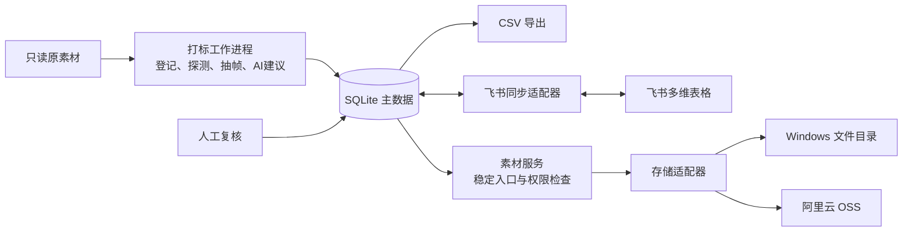

# 素材打标项目：设计与实施方案

日期：2026-11-06。状态：提案，尚未部署或实现。

## 1. 建议与本次初始化范围

建议先采用 **Windows 文件服务 + 本机打标工作进程 + 单机 SQLite 主数据 + CSV 导出**，再接飞书多维表格，最后按需要迁移文件到 OSS。采用单服务、模块化实现，不在第一期引入多服务集群、向量数据库或自建对象存储集群。

本次已建立 Git main 分支、README、AGENTS、忽略规则与本方案；保留原始模板。未安装运行依赖、未连接 Windows、未复制原素材、未调用模型批量打标、未写飞书、未修改 doctor-video-automation。

参考 doctor-video-automation 的 AGENTS.md 与 docs/ROUTER_WORKER_DESIGN.md：沿用模板与任务分离、原文件只读、版本绑定、可续跑、实际校验和可追溯记录。剪辑/包装流程及其历史授权不复制到本项目。

## 2. 目标与假设

- 输入：图片、视频、GIF、贴纸、音效、BGM、文献截图。
- 输出：保留现有素材表 35 列、缺口表 14 列的表格；内部数据另存工程字段，不向表头塞入运行状态。
- 初期假设：少量协作者、一个主写入进程、Windows 常开且有稳定内网。实际素材量、容量、Windows 版本、备份盘与外网使用需求尚未核实。
- 模板中提到的 259 条 footage 是原方案背景，尚未核实为本项目当前库存。
- “飞书文档”按所给模板理解为飞书**多维表格**。若最终使用普通电子表格或 Docx 文档，应调整输出适配器；附件、关联和人员语义不能直接照搬。

## 3. 整体结构



推荐实现栈：Python + FFmpeg/ffprobe + SQLite，文件与索引 API 用 FastAPI；需要多人页面时再补轻量网页。此为技术建议，不代表已创建工程或锁定依赖版本。

第一期权威数据库放在本机本地磁盘，Windows 只承担文件服务；本机关闭时文件下载仍可用，打标和导出暂停。稳定下载入口以 asset_id 访问 Windows 上经发布的文件映射清单，不依赖本机在线。

多人使用阶段将 API、唯一写入进程和数据库整体移到常开 Windows 主机本地磁盘；本机工作进程通过 API 领任务、交结果。**不让多台电脑通过 SMB 直接打开同一个 SQLite 文件。** 确有高并发写入需求时再迁移 PostgreSQL。数据库迁移和文件后端迁移分别处理。

## 4. Windows 文件服务器如何建立

### 路线比较

| 路线 | 适用 | 成本与限制 | 建议 |
| --- | --- | --- | --- |
| 只有 SMB 共享 | 单人试验、手动浏览 | 配置最少；表格网页下载体验差，路径依赖系统 | 仅作临时验证 |
| Windows 目录 + 素材 HTTP 服务，SMB 辅助 | 内网团队、后续迁移 OSS | 需维护一个轻量服务；可用统一入口隔离物理存储 | 推荐 |
| Windows 上先部署对象存储服务 | 已有对象存储运维经验 | 多一层服务、升级和备份；仍需验证 OSS 差异 | 当前无必要 |
| 直接 OSS | 远程协作优先 | 需要云账号、上行带宽与持续存储/请求/下行费用 | 外网需求强时选择 |

### 推荐落地步骤（选定后实施）

1. 盘点 Windows 版本、磁盘可用空间、现有数据、网络和管理员权限。固定 DHCP 租约或内网 IP，建立内部 DNS 名称；设定常开与服务故障重启。
2. 独立数据盘建立下列目录。库容量按“原件 + 预览/代理 + 导入暂存峰值 + 备份”实测估算，不用素材条数推算容量。

```text
D:\MediaLibrary\
  incoming\       人工投递区，导入前暂存
  objects\        正式原件，按哈希分层，不按科室移动
  derivatives\    缩略图、抽帧、预览代理
  manifests\      已发布的 asset_id 到对象的映射快照
  service-data\   服务状态；多人阶段数据库在此本地存储
```

3. 单独服务账户读写对象库；剪辑师只读正式库、可写投递区，管理员独立。SMB 共享权限与 NTFS 权限同时配置；无匿名共享。只向内网/VPN 开放必要端口，SMB 不映射公网。
4. Windows 原生运行轻量 HTTP 服务，作为系统服务自动启动；前置 HTTPS 入口，证书需受客户端信任。支持登录、权限检查、Range 视频预览、下载文件名与访问日志。具体服务托管方式在核实系统版本后确定，无需先强制上 Docker/WSL。
5. 服务只按登记的 asset_id 查映射，不能接收任意磁盘路径；临时上传写暂存文件，完成大小及哈希校验后原子发布。首次只复制、不移动原件。
6. 备份到另一块物理设备或后续云端：原件增量备份，数据库用一致性快照，映射清单/词表/配置同步备份，凭证单独保管。试运行建议每日备份，每月做一次恢复演练；目标 RPO 24 小时、RTO 一个工作日，需由实际业务决定。磁盘镜像不能替代备份。

Windows 支持局域网文件共享；具体账户与共享设置以 [Microsoft 文件共享说明](https://support.microsoft.com/en-us/windows/experience/connectivity-networking/file-sharing-over-a-network-in-windows) 为依据。网络边界参考 [Microsoft SMB 安全指南](https://learn.microsoft.com/windows-server/storage/file-server/smb-secure-traffic)。上述目录和服务组合是本项目建议。

### 内网与飞书的关系

飞书里的下载链接由使用者的电脑打开：电脑在内网或接入 VPN 时才能访问内网服务，离开内网就无法下载。飞书不会把内网服务器自动变成公网文件服务。

飞书“预览”附件由内网同步进程主动上传小缩略图到飞书，再把 file_token 写入记录；不能把 `D:\...` 或 SMB 地址当作附件。只上传预览不等于原文件已上云。飞书支持先上传素材、再用 file_token 写附件字段，见 [多维表格 API FAQ](https://open.feishu.cn/document/docs/bitable-v1/faq?lang=zh-CN)。

若要在外网访问原件，选择 VPN 或提前使用 OSS。是否允许素材/预览交给云端模型与飞书，在选模型及接入时确认实际数据范围，不默认为所有原件可上传。

## 5. 随时切换到 OSS 的设计

### 身份与存储分离

| 概念 | 拟定表达 | 迁移是否改变 |
| --- | --- | --- |
| 素材身份 | 内部不可变 UUID；展示 ID 沿用 M0070 等，冲突时保留命名空间与别名 | 不改变 |
| 内容身份 | 原件 SHA256 | 字节不变则不改变 |
| 对象键 | `originals/ab/<sha256>.mp4` | 两种后端保持相同 |
| 物理位置 | provider、root/bucket、object_key、verified_at | 可新增/切换 |
| 下载入口 | `https://<受控域名>/assets/<id>/download` | 保持域名和路由稳定 |
| 本地路径 | 已登记来源库根目录下的相对路径 | 仅作历史来源，不作为下载依据 |

“本地路径”继续保留模板的相对路径语义，内部另记 source_repository/source_root。不能把 Windows 盘符或 OSS key 偷换进该列；没有可靠来源路径时留空。

设计存储接口：`put / stat / open_range / create_download_url / copy / verify`。Filesystem 与 OSS 各自实现；业务层不拼 SMB 或 OSS URL。对象不可变；修改素材生成新哈希、新版本和衍生关系。缩略图键同时包含原件哈希与生成规则版本。

下载入口先认证：Windows 后端流式读取文件，OSS 后端生成短期签名地址并重定向。表格永远保存入口地址。OSS 私有对象签名 URL 有有效期，因此不适合作为永久索引地址，见 [OSS 签名下载说明](https://www.alibabacloud.com/help/en/oss/user-guide/how-to-obtain-the-url-of-a-single-object-or-the-urls-of-multiple-objects)。

**文件切到 OSS 不等于入口自动公网可用。** 若希望外网使用，同时将轻量下载网关部署到可访问主机并迁移 DNS/认证配置；OSS 负责对象文件，网关继续负责稳定入口。

### 迁移过程

1. 生成迁移清单：素材 ID、对象键、大小、SHA256、源位置、目标位置与状态，新增文件进入增量队列。
2. 复制到私有 OSS Bucket，使用断点续传与可重试任务。大文件策略参考 [OSS 上传方式](https://www.alibabacloud.com/help/en/oss/user-guide/upload-objects-to-oss/)。
3. 每个对象校验大小及实际读取内容的 SHA256；保存校验记录，不能以文件名、上传成功或 ETag 替代 SHA256。重读会有时间和流量成本，试点时测量。
4. 只给已校验对象新增可读位置，再逐批切换优先后端；新增写入切换前处理完旧队列并做最终增量核对。
5. 旧库保持只读作为回退。OSS 不可用时仅对旧库仍有的已校验副本回退；切换后新入库对象若要求可回退，也必须反向复制并校验。
6. 验证素材数量、哈希、实际下载、Range 预览和飞书入口后再结束迁移。旧文件保留期建议至少 30 天，删除另行决定。

“随时切换”指接口和身份预先解耦，不代表 TB 级文件能瞬间传完。先复制校验，再切路由，可逐个对象迁移，标签无需重打。

## 6. 数据模型与表格契约

SQLite 是主数据，CSV 是导出快照；飞书接入后是协作编辑界面，按字段归属同步。不能让 CSV 和飞书同时无规则地充当主库。

建议内部实体：assets（稳定 ID 与当前版本）、blobs（哈希/大小）、asset_sources（来源/旧路径/别名）、storage_locations（多后端位置）、derivatives、tag_suggestions、effective_tags、field_revisions、review_events、jobs/stages、sync_outbox、feishu_mapping、gaps。

同字节文件复用一个 blob，来源记录分别保留；许可和来源不同不能因哈希相同而自动合并掉。原有多个素材 ID 可通过别名关联，存在来源冲突时进入复核。飞书同步以内部稳定 ID 对应 record_id，SHA256 作内容校验与重复检测，不作为唯一业务身份。

### 字段归属

| 类别 | 字段与处理 |
| --- | --- |
| 脚本控制 | ID、SHA256、路径、下载入口、预览、方向、分辨率、时长、透明底、有原声、曾用任务/原话、入库日期。来源导入的原话/任务必须有依据 |
| AI 建议、人工可修订 | 类型、用途、主体、表现形式、检索词、文字/标注、人脸、片段、情绪；人工改过的值不被后续 AI 覆盖 |
| AI 建议、人工逐条确认 | 科室、器官/系统、疾病/症状、过程/状态 |
| 人工控制 | 来源、页面、许可、署名、医学备注、不适用场景、标签状态、打标人。新行可由系统初始化“AI初稿”“未核实”，不得自动晋升“已人工确认” |

飞书接入后人工字段以飞书为准，本地保存副本和修订历史；接入前通过本地复核入口写入。切换编辑入口时完成一次基线对齐，避免两个地方同时编辑。同一行的“已人工确认”须绑定素材版本、相关有效标签和审核记录；内容变化后标记需复核，旧审核历史保留。

### 模板中待补齐的问题（原文件暂不改）

- 科室含“…”、器官只有示例、疾病列表未给出：先提取有依据的种子候选，由管理人发布词表 v1；模型建议新词进入候选清单，不能当已锁定选项。
- “带文字/标注”只含无/英文/中文：中英混合、其他语言无法准确表达；建议增补混合/其他/待确认，需选定后改字段契约。
- 音频没有方向/分辨率，图片没有时长；这些值留空。内部 true/false/unknown 三态不能把“未检测”导出为 false；飞书复选框无法表达 unknown 时放入单独的质量报告，未检测完成项不当作技术字段完整。
- 含 alpha 通道不一定实际透明；有音轨不一定有可听声音。需分别检测实际透明像素与音频内容，区分容器信息和语义标签。
- 人员字段需要真实飞书用户 ID；AI 不能填写虚构员工。缺口表“提出人填 AI”与人员类型不兼容，建议人员留空、内部记录 actor_type=ai，或后续明确改字段类型。
- 标签状态在文字说明中有空格、CSV 枚举为“AI初稿”；导出以 CSV 值为准，导入时做明确规范化映射。
- CSV 无法携带飞书附件、人员与关联的真实对象类型：CSV 先供查阅/导入，后续 API 才写附件 token、用户 ID、关联 record_id。缺口关联素材用已保存的 ID 映射解决。

## 7. 打标流水线与复核

拟定阶段：扫描 → 稳定文件检查 → SHA256/重复检查 → 技术探测 → 预览/抽帧 → AI 建议 → 契约校验 → 人工复核 → 索引发布与表格导出。

每步记录输入哈希、规则/词表/模型版本、结果文件、耗时、失败类型；任务失败只重试对应阶段，建议瞬时错误最多重试 3 次，鉴权/输入错误直接等待处理。中断可恢复，同一批次重跑不重复建行。应用标签使用版本条件，防止覆盖期间的人工修改。

- 图片看实际原图，OCR 记录画面文字；文献截图只描述可见内容，不凭截图补造论文结论。
- 视频先首/中/尾抽帧作内容概览，对变化过程、动作和可用片段再增加时序采样并看连续短片；仅 3 帧不足以确认“肿胀→消肿”。混合内容按区间留证据。
- GIF 检查完整周期；音效/BGM 需实际音频分析或试听，不拿静帧打语义标签。
- 每个建议保留图片/帧时间/片段依据和模型版本；模型自报置信度只辅助排序，不等同准确率。
- 无法判定的主题和方向留空或待复核，技术状态放内部字段，保持外部标签状态两项不乱扩。
- AI 初稿可导出供查找，但与“已人工确认”明确区分。医学关键字段未确认，不自动将整行标为确认。

试点选 30 条，覆盖不同素材类型、医学科室、正反变化方向、带字、重复文件、音频、损坏文件。逐条人工核对；统计字段准确率、未判定率、方向错误、耗时和模型费用。方向错误必须修正且验证后，才扩大到全量。全量时先跑技术信息，再按批次跑语义分析，支持预算上限和暂停。

## 8. 飞书同步方案

第一步单向推送新素材和脚本字段；第二步接入人工字段回流。按 table_id/field_id/record_id 保存映射，不依赖字段显示顺序或行号；字段名改动时检测 schema 差异。

写入走持久 outbox：稳定素材 ID、操作 ID、目标字段、基线值与预期新值。请求超时先查远端并对账，再决定重试，避免“新增成功但响应丢失”造成重复行；记录逐条成功/失败，不把整个批次直接视作成功。

按字段做三方比较：上次同步值、本地值、远端值。只有一方变更按字段归属处理；双方变更且不一致进入冲突报告，不按最后时间覆盖。人工修改保留修订记录。第一期不自动传播删除；远端删行标为缺失等待处理，删除素材采用软删除，不连带物理删除原件。

同步写前生成差异清单，试点授权后可定期自动同步已选字段。附件上传失败只重试附件，不重复新建整行。多选传数组、数字传数字、超链接/人员/附件/关联按实际 API 类型编码，不能直接把 CSV 字符串原样发送。

API 权限、限额、批量大小和租户可用功能在接入时查当前官方文档并做小批实测，不将今天的限额写死。预览、同步日志及密钥不混放；使用最小所需应用权限。

## 9. 拟定工程组织

```text
asset-index-template/   用户原始模板与规则，现有
docs/                   方案、部署手册、迁移及验收，现有
config/                 后续：无密钥配置示例、字段映射、已发布词表
src/media_tag/          后续：catalog、pipeline、storage、tagging、export、sync
scripts/                后续：命令入口，复用 src 内公共逻辑
tests/                  后续：去重、契约、人工值保护、同步与存储切换测试
jobs/<job_id>/          运行时：manifest、分阶段证据、review、report
data/ cache/ outputs/   运行时：数据库、缓存、导出快照；Git 忽略
```

拟定命令职责为 scan、probe、tag、review、export、sync、migrate-storage，当前没有可执行命令。CSV 采用 UTF-8 BOM，表头顺序严格跟随模板；对外部文件名等字段做电子表格公式注入防护，内部原值保留。写出使用临时文件与原子替换，同时输出快照版本和数据校验报告。

## 10. 分阶段实施与验收

| 阶段 | 交付 | 验收标准 |
| --- | --- | --- |
| P0 方案确认 | 存储路线、部署位置、表格形态、词表归属 | 本文关键决策明确 |
| P1 本地闭环 | 字段契约、SQLite、扫描探测、文件适配器、CSV 导出 | 两张表头逐列一致；重复扫描不重复建行；中断恢复；原件哈希不变；异常文件可定位 |
| P2 AI 与复核 | 模型适配器、证据记录、30 条试点、人工修订 | 逐字段有依据；变化方向逐条核对；重跑保护人工值；费用和失败率实测 |
| P3 Windows 服务 | 下载入口、登录、对象映射发布、备份恢复 | Mac/Windows 真机可下载与拖动视频预览；未授权拒绝；断线可恢复；备份可还原 |
| P4 飞书 | 字段映射、预览上传、增量推送、人工回流 | 新增超时重试无重复；人工编辑不丢；冲突可见；缺口关联正确 |
| P5 OSS 演练 | OSS 适配器、复制校验、分批切换与回退 | 同一个入口切换后字节一致；ID/标签不变；未迁移和新入库对象均按策略可读 |

P1/P2 可用少量本地文件先跑，不必等待服务器部署；P3 用于团队使用。P1 就定义双后端接口，P5 再连接真实 OSS 验收。开发工期与费用需在机器、素材样本、模型路径确认后估算，不沿用旧方案“全量 1～2 天”的承诺。

必要测试覆盖：哈希重复而来源不同、同名不同内容、中文长路径、损坏媒体、音频空技术字段、生成阶段断电、人工修订后 AI 重跑、飞书新增响应丢失、双方并发修改、迁移中断及切换后新对象回退。检查通过与人工标签确认分别记录。

## 11. 用户需要决定的事项

| 决策 | 建议默认值 | 选择其他方案的触发条件 |
| --- | --- | --- |
| 文件服务 | Windows 目录 + HTTP 下载入口，SMB 辅助 | 若必须外网随时下载，优先 OSS 或 VPN |
| 打标部署 | 初期本机运行，Windows 保存文件 | 本机不常开或多人排队时，API/数据库/工作进程迁往 Windows |
| 表格入口 | 先 CSV，后飞书多维表格 | 第一日起需多人审核则提前 P4 |
| AI 路径 | 接口解耦，先用小批样本比较可用模型 | 本地模型优先保护数据范围；云模型需明确可上传范围、账号和预算 |
| 词表维护 | 由你指定一个管理人发布 v1 | 不完整前仅产候选，不能自动扩词表 |
| 原库关系 | 只读接入 doctor-video-automation，独立索引 | 要回写旧库时单独设计兼容发布步骤 |

实施前只需补齐：Windows 版本及硬盘容量、素材总容量、同时使用人数、是否需要外网访问，以及可用模型/账号和预算。无需在聊天中提供密码或 AccessKey。
