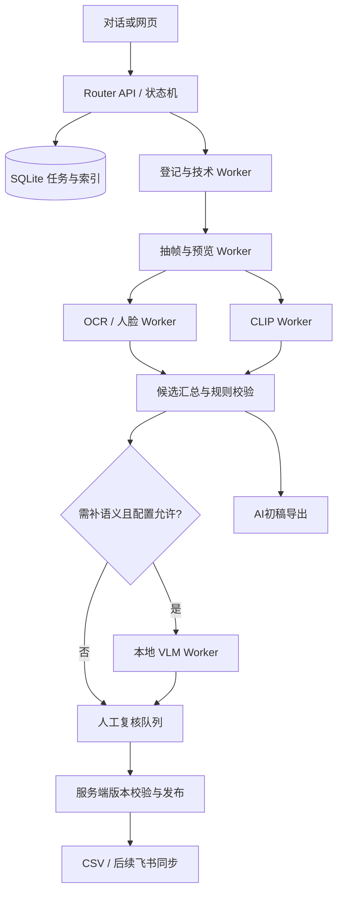

# 小模型优先的素材打标与 Router/Worker 实施方案

日期：2026-11-06。状态：可下发的开发提案；文中的命令、接口、目录、策略均待实现，未运行模型或部署 Windows 服务。

本方案细化 DESIGN_AND_IMPLEMENTATION.md 的模型与执行层。用户提供硬件：Intel i5-14400F、32GB 内存、RTX 5060 8GB；Windows 版本、驱动、硬盘容量和外网需求尚待核实。

## 1. 结论与推荐配置

打标不必全部依赖大模型。采用“脚本确定事实 → 专用小模型产生证据与候选 → 小型视觉语言模型补描述 → 人工确认关键字段”。更大的云端模型只作为可选疑难处理，不是运行必需条件。

两类“小模型”应区分：OCR、检测器、CLIP 是专用模型；2B 视觉语言模型仍是生成式多模态模型，只是参数更小。前者适合识别/匹配，不能自动承担完整医学描述和时序推理。

| 层级 | 拟选工具/模型 | 负责字段 | 不负责 |
| --- | --- | --- | --- |
| 确定性脚本 | SHA256、ffprobe、FFmpeg、图像像素检查 | 哈希、尺寸、方向、时长、透明像素、音轨与静音检测、路径、预览 | 不凭文件名生成语义 |
| 文字检测识别 | PaddleOCR 轻量检测与识别，PP-OCRv5 mobile 作为可复现基线 | 可见文字、文字框、语言线索，辅助“带文字/标注” | 画面文字不是医学结论或来源证明 |
| 图文匹配 | Chinese-CLIP ViT-B/16；资源受限时对比 RN50 | 用途/表现形式/主题候选、中文检索排序 | 不自由生成描述，不确认病理和变化方向 |
| 人脸检测 | OpenCV YuNet | 帧内人脸候选及位置 | 不识别人、不保证全视频无人脸、不宣称完成脱敏 |
| 语义补全 | Qwen3-VL-2B-Instruct，优先测试受支持的 4-bit 推理 | 主体描述、检索词、静态/对比/变化候选、候选时间段 | 不填写许可，不代替医学确认，不保证输出事实正确 |
| 音频语义（后续） | PANNs 的轻量变体作音频事件基线 | 掌声、音乐、说话等事件候选 | 不把事件类别直接当作“轻松/警示”等情绪 |
| 人工 | 播放实际片段、复核来源记录 | 科室、器官、疾病、方向，来源/许可及状态 | 不能用模型一致性替代人工确认 |

第一期只必须实现脚本、OCR、CLIP、复核与导出；YuNet 可同批接入，2B 视觉语言模型是增强阶段。音频先提技术字段，其余留待试听；后续确有足量音效/BGM 再接 PANNs。不把音频交给只接收图像的模型。

无生成模型也可以工作：按已发布字典生成候选，用人工写主体/过程；自动化覆盖率较低，但不需要云端 API。一般视觉分类模型的预置类别不能覆盖医学器官/病理词表，不作为统一打标核心。

模型依据：Chinese-CLIP 官方列出 ViT-B/16 188M、RN50 77M 参数，定位图文检索与表示学习，见 [官方仓库](https://github.com/OFA-Sys/Chinese-CLIP)。OCR 模型按指定版本固定权重，不追随网站默认值漂移，见 [PaddleOCR 官方模型文档](https://github.com/PaddlePaddle/PaddleOCR/blob/main/docs/version3.x/module_usage/text_recognition.en.md)。YuNet 见 [OpenCV 官方模型](https://github.com/opencv/opencv_zoo/tree/main/models/face_detection_yunet)。2B 多模态模型见 [Qwen 官方模型卡](https://huggingface.co/Qwen/Qwen3-VL-2B-Instruct)。音频基线见 [PANNs 作者仓库](https://github.com/qiuqiangkong/audioset_tagging_cnn)。上述项目的能力不代表已在本医学素材集上验证。

## 2. 这台机器怎样部署

推荐最终由 Windows 同时运行素材服务、Router 服务、SQLite 与 Worker；开发阶段可先在本机完成代码与假数据契约测试，随后在 Windows 实测。相较初版“本机执行打标”，用户提供的独显使常开 Windows 本地推理成为优先建议，仍需选定后部署。

| 资源 | 起步配置（待实测调优） |
| --- | --- |
| CPU | 探测/抽帧最多 2 个任务并行，OCR/YuNet 优先 CPU；限制 FFmpeg 线程避免抢占 |
| GPU | 全局只有 1 个推理槽；CLIP 与 VLM 分批加载，批次切换时释放前一个模型 |
| 内存 | 32GB 用于系统、缓存及模型装载；队列只保存引用，不把全部视频解码到内存 |
| VLM | batch=1，从单图、少帧短片起步；2B 4-bit 只是候选，依赖量化内核支持与实际显存测量 |
| 数据库 | 本机磁盘 SQLite，所有任务/标签写入经过同一服务；远程 Worker 走 API |
| 服务 | Windows 原生 Python 为第一选择；隔离 core/vision/vlm 环境；仅兼容性失败时评估 WSL2 推理 Worker |

2B 权重按 4 bit 算约 1GB 是理论权重下限，不是运行显存需求；实际还有视觉编码、缓存、激活与框架开销，8GB 是否容纳具体帧数/分辨率必须实测。不建议把 7B/8B、多模型常驻或长视频直接推理作为首期配置，不先购置新硬件。

初始化先测 `nvidia-smi`、框架 CUDA 可用性、矩阵运算和各模型单样本推理，再锁定 Python/驱动/框架/权重/量化版本。不能仅因能 import 就标为 GPU 可用，也不复制相邻项目的旧 torch 环境。

PyTorch 已提供 Blackwell 支持，具体 CUDA wheel 必须与选定版本匹配：参见 [2.7 发布说明](https://pytorch.org/blog/pytorch-2-7/) 与 [当前版本安装矩阵](https://pytorch.org/get-started/previous-versions/)。这些资料证明有支持路线，不能保证任意量化内核在该 Windows/5060 组合上可运行。

## 3. 运行时 Router 与 Worker

沿用 doctor-video-automation 的“Router 驱动唯一服务端执行路径”原则。对话入口负责把“给这批素材打标”转成请求；真正的 Router 是确定性程序，负责依赖、版本、配额与状态，不为每条素材调用语言模型。Worker 是固定职责进程，不等同于一个聊天代理。



人工复核不是自动 Worker；Router 不模拟人的确认。AI 初稿可导出，完成技术检查或模型运行不意味着已经人工确认。文件下载服务独立于 GPU Worker，模型失败不影响已入库文件读取。

| 运行 Worker | 输入 | 产物 | 资源/权限 |
| --- | --- | --- | --- |
| ingest_probe | 已授权来源根目录、文件清单 | 源引用、SHA256、技术信息、重复/损坏报告 | CPU；只读源文件 |
| evidence | 已登记 blob 和采样规则 | 缩略图、带时间戳帧、音频片段、采样覆盖记录 | CPU；只写本 attempt 目录 |
| ocr_face | 帧与图像证据 | 文字框/文本/检测置信度、人脸框、覆盖范围 | CPU；不写业务标签 |
| clip | 图像证据、发布词表、文本模板 | 按字段候选、分数、top-k、表示向量 | GPU 槽；无词表编辑权 |
| vlm | 原图/时序帧、证据、候选、目标字段 | 结构化建议、依据、不能判断的原因 | GPU 槽；无发布权 |
| validate | 各 Worker 产物与契约版本 | 字段问题、待复核清单、可导出草稿 | CPU；服务端规则 |
| export_sync | 服务端已发布快照 | CSV、同步差异、执行回执 | 导出本地；后期按授权访问飞书 |

## 4. 路由规则：什么时候用小模型、什么时候升级

1. 对全量素材先跑确定性信息，哈希与探测缓存命中则复用。图片/视频与音频分支独立。
2. 对图像/视频跑 OCR 与 CLIP；固定标签通过发布词表的规范名、同义词、描述模板编码。视频分镜/分段打候选，避免整片平均把不同器官混成一个标签。
3. CLIP 给各字段 top-k。单选以校准阈值和第一/第二名间距筛选，多选逐标签校准。**相似度不是概率**，不写固定“0.8 即正确”的通用规则；未校准前仅显示候选，不自动选择有效值。包含无关/无法匹配用例评估拒识。
4. 有明确模板候选时可以形成 AI初稿；缺自由描述、候选冲突、多主体或需要时序解释时才送 VLM。全量描述模式可显式启用，但会增加本地耗时。
5. 医学器官、疾病与变化方向无论模型分数多高都进入人工逐条确认。只看到鼻腔不能自动推断鼻炎；OCR 出现病名也不是确诊证据。
6. 云端 VLM 默认关闭。以后启用时由数据范围、预算、目标字段和实际可用供应商共同决定；关闭或预算耗尽直接进入人工队列，不无限升级模型。
7. 模型结果和有效值分开。人工值加版本/操作者记录；重新打标只能新增建议，不能覆盖人工值。

视频采样起步策略：静态概览首中尾，加场景切换点；对过程类候选取目标区间连续采样，先以短窗口、少帧验证显存，再逐步扩大。达到采样上限时记录未覆盖区间，不能输出“整条无文字/无人脸”。方向建议保存起/终状态、时间区间和帧证据；可靠性不足直接待复核。抽帧能帮助判断，不能替代人工查看连续过程。

OCR 识别出混合语言、音频无方向、未知透明状态等现有表头无法表达的问题，保留内部证据和质量报告；在表头变更获确认前不擅增枚举，也不把 unknown 映射为 false。

## 5. 任务协议、续跑与发布

服务端数据库中的运行记录是唯一任务状态源，`jobs/` 中 JSON 是快照/证据。不要另做一套需要手工维护状态的 YAML 工单。

拟定任务包示例（字段值仅示意，非已执行任务）：

```json
{
  "task_id": "task-example", "job_id": "pilot-example",
  "asset_id": "asset-example", "asset_revision": 1,
  "stage": "clip", "attempt": 1, "lease_epoch": 1,
  "input_refs": [{"kind": "frame_manifest", "ref": "evidence/frames.json", "sha256": "<实际哈希>"}],
  "versions": {"schema": "v1", "taxonomy": "<已发布版本>", "model": "<权重修订>", "preprocess": "v1"},
  "target_fields": ["用途大类", "表现形式"],
  "limits": {"timeout_seconds": 300, "max_attempts": 3, "gpu_slots": 1},
  "output_prefix": "jobs/pilot-example/runs/task-example/attempt-1/"
}
```

结果必须带 task_id、attempt、lease_epoch、输入指纹、模型/预处理版本、产物引用及哈希、分字段证据、耗时/峰值资源、错误码；状态区分 succeeded、partial、failed、not_applicable。未实际推理不得输出 succeeded。延迟、超时参数按试点调整。

服务端执行规则：

- 任务状态为 queued → leased → running → succeeded / retry_wait / failed / needs_attention / cancelled。人工审核状态单独管理，不与阶段成功混用。
- 原子领取任务；起步租约 120 秒、心跳 15 秒，耗时任务持续续租。租约过期可重领，每次递增 lease_epoch；旧 Worker 返回结果只留审计，不采用。
- 缓存键至少包含内容哈希、证据哈希、阶段配置、模型权重、提示词、词表、schema 版本。标签修订采用时另查 asset_revision，不能只检查文件哈希。
- 执行语义按“至少一次”设计；接受结果用 task/epoch 唯一约束，数据库事务保证一次采用。Worker 不直接写主库或飞书。
- 默认最多 3 次总尝试（含首次），退避重试瞬时错误。鉴权、损坏文件、未发布词表和 schema 错误直接 needs_attention；不无限重试。
- OOM 最多一次受控降载尝试（计入总尝试数），减少批量/帧数或分辨率并生成新的输入指纹，记录覆盖变化；仍失败则转人工/等待，不能无日志地换模型。
- GPU 槽只有一个；心跳丢失时先确认旧进程终止或 GPU 已释放，再启动替代进程，防止租约过期产生两个 GPU 进程。
- 新反馈按 asset_id + target_fields 合并，旧任务取消/失效只影响变更字段；成功的技术探测和证据可复用。
- 发布由唯一服务端校验契约、输入版本和人工值保护，在事务中采用，CSV 从一致快照生成并原子替换。飞书走 outbox，失败不重复建行。

拟定 API：`POST /jobs`、`GET /jobs/{id}`、`POST /jobs/{id}/cancel`、`POST /worker/claim`、`POST /worker/heartbeat`、`POST /worker/result`、`POST /assets/{id}/review`、`POST /exports`。claim/result 使用受限 Worker 身份，review 使用人工身份；对话、网页、CLI 都走同一服务端。原文件路径仅允许已登记根目录，任务包不能携带任意 shell 命令。

## 6. 试点与是否需要大模型的判定

先选 30 条跨类型样本做兼容性与流程验证：建议 12 视频（含正反方向）、8 图片、4 GIF/贴纸、4 音效/BGM、2 文献截图；不足类型如实记录，另加重复、损坏、并发修改等工程测试夹具。

同一批可评估样本比较两组：A=脚本+OCR+CLIP；B=A+本地 2B VLM。云端对照 C 仅在获准后加入。各类型/字段单独计分，不能因为一组留空多、只预测简单样本就宣称更准确。

记录人工可接受建议数/非空建议数、覆盖率、医学方向错误数、多选 precision/recall、检索 recall@5、每条人工修订时间、P50/P95 耗时、峰值显存、重试与模型升级比例。只有请求日志中有实际计费信息才记费用；本地成本记录运行时间，不虚构 token 或金额。

30 条只验证链路并探索阈值。后续扩到至少 100 条或可用库的代表性样本，按原件/来源分组划分校准集和独立验收集，不能让同视频抽帧同时落入两边。阈值只在校准集定，验收集不用于调参；样本不足明确不确定性。

工程验收：重复运行不增重复行、人工修订不丢、损坏媒体可定位、任务中断可恢复、旧租约结果不生效、原文件哈希不变、未审核不得变成已人工确认。

建议业务试运行目标：对允许自动填写的普通字段，独立样本上的非空建议接受率达到 90%，同时报告覆盖率；该值是拟定验收目标，不是当前模型表现。医学字段仍逐条人工确认。若 VLM 未减少修订时间或新增明显错误，则关闭对应字段的 VLM；若仅少数复杂样本困难，人工处理往往比全量更大模型更合适。

## 7. 可下发的开发任务卡

以下是开发任务，不是运行时素材任务，也不表示现在已经启动 Worker。主 Router 先分派 D00 固定契约，再按依赖派发。并行开发必须在隔离分支/工作树中进行；共享契约、依赖清单与文档索引由集成者合并，Worker 不互相改公共文件。

每张任务卡下发时附：本卡全文、AGENTS.md、依赖任务产物与基准提交、实际允许写入路径、相关 schema。所有 Worker 返回：改动清单、产物/提交、实际检查命令及结果、剩余问题。不得使用假推理结果证明模型已可用。

### D00 — 契约与项目骨架（先行）

- 输入：本方案、用户本地 `asset-index-template/`、AGENTS。
- 修改范围：`pyproject.toml`、`src/media_tag/contracts/`、`tests/contracts/`、`docs/contracts.md`，必要目录 README。
- 产物：35/14 列契约加载器、内部建议/有效值/证据/任务协议、词表发布与缺失检查、依赖锁定策略。用户模板不复制进 Git；只记录摘要指纹/版本，测试用合成最小夹具。
- 验收：真实模板能解析且顺序一致；缺模板时明报错；unknown、不适用、AI建议、人工确认可区分；未发布词表不可当正式词表使用。

### D01 — 目录与索引核心（依赖 D00）

- 修改范围：`src/media_tag/catalog/`、`src/media_tag/storage/`、`tests/catalog/`、`tests/storage/`。
- 产物：SQLite 迁移、asset/blob/source/location/revision 实体、Filesystem 适配器、OSS 接口空实现（明确未配置）、快照与事务采用函数。
- 验收：同名异内容分开；同内容不同来源保留来源；路径越界拒绝；写入失败回滚；并发修订冲突可见；原文件不变。

### D02 — 技术提取与证据（依赖 D00）

- 修改范围：`src/media_tag/workers/probe.py`、`src/media_tag/workers/evidence.py`、`tests/evidence/`。
- 产物：ffprobe/哈希、图片/GIF/视频/音频分流、时间戳抽帧与采样覆盖、衍生物指纹、错误分类；通过已冻结接口读文件，不另写存储层。
- 验收：旋转元信息、透明像素、静音音轨、图片空时长、长视频预算、损坏文件、中文路径；帧时间须对应真实解码，不伪造覆盖。

### D03 — Router 服务与队列（依赖 D00、D01）

- 修改范围：`src/media_tag/router/`、`src/media_tag/api/`、`tests/router/`。
- 产物：任务 DAG、claim/heartbeat/result、租约与 fencing、单 GPU 槽、取消/增量修订、状态查询、预算限制。先接测试用 dummy Worker 验证调度，报告注明未做模型推理。
- 验收：杀进程后可恢复；旧 lease 结果被拒；重复结果只采用一次；暂停后不派新任务；旧 GPU 未退出不派替代；Worker 无发布权限。

### D04 — 专用模型 Worker（依赖 D00、D02；端到端依赖 D03）

- 修改范围：`src/media_tag/workers/ocr.py`、`face.py`、`clip.py`、`src/media_tag/models/`、`tests/models/`，专用环境锁定文件由集成者确认。
- 产物：OCR、YuNet、Chinese-CLIP 适配器、模型版本注册、候选与证据输出、字段级校准工具、CPU/GPU 实测报告。
- 验收：各模型至少实际处理一个样本；下载/推理失败明确失败；CLIP 分数不伪装概率；未知样本可拒识；人体/图片文字不被当许可或医学确认。

### D05 — 本地 VLM 增强（依赖 D00、D02、D03；候选融合依赖 D04）

- 修改范围：`src/media_tag/workers/vlm.py`、`src/media_tag/models/vlm/`、`tests/vlm/`。
- 产物：2B 模型装载与可用量化路线、JSON 建议解析、时序证据绑定、选择性路由、OOM 降载、云端 disabled 接口。
- 验收：5060 实机图像/短片推理记录、峰值显存及耗时；乱 JSON、幻造标签、超时和缺证据可拦截；无法可靠运行时提交真实失败及纯小模型回退，不阻塞基础闭环。

### D06 — 人工复核与 CSV（依赖 D01、D02、D03；可先用合成建议测试）

- 修改范围：`src/media_tag/review/`、`src/media_tag/export/`、`web/review/`、`tests/review/`、`tests/export/`。
- 产物：轻量复核页（原图/片段、证据、建议/有效值、逐字段确认）、版本冲突提示、35/14 列 CSV 输出、公式注入防护、质量报告。
- 验收：AI重跑不覆盖人工；片段可播放并定位；不能批量假确认医学字段；导出列序正确；中断保留上次快照；业务未知状态不被静默改成否。

### D07 — Windows 部署与试点集成（依赖 D01～D04、D06；D05 可选）

- 修改范围：`scripts/windows/`、`tests/integration/`、`docs/windows-deployment.md`、`docs/pilot-report.md`；根依赖和索引由本任务集成者统一维护。
- 产物：系统/驱动核验、环境安装与服务自启动说明、受限账户和下载 API、数据库备份恢复、30 条 A/B 试点报告；素材与报告原始数据留忽略目录。
- 验收：Windows 真机服务重启可恢复、Mac 可下载与预览、断点任务可继续、备份还原一致；报告分清本机假数据检查与 Windows/模型真实检查。

### D08 — 飞书与 OSS（基础闭环稳定后）

- 依赖：D07；需要确定外网需求、飞书目标及实际接入授权。
- 修改范围：`src/media_tag/sync/`、`src/media_tag/storage/oss.py`、相关 tests 与部署文档。
- 产物：字段归属映射、outbox/冲突回流、附件上传、OSS 复制校验/切换/回退。
- 验收：重试不重复建行；人工值不丢；相同入口切后端可下载相同字节；临时签名不落表；未迁移与切换后新对象回退符合策略。

### 下发顺序与工作量

```text
D00 → D01 ─→ D03 ───────────────┐
    → D02 ─→ D04 → D05(可选) ──┤
         D01+D02+D03 → D06 ────┤
                               D07 → D08
```

建议首次只下发 D00～D04 和 D06，得到“专用小模型 + 人工复核 + CSV”闭环；之后用 D05 比较是否值得加 VLM。开发任务并行不代表 GPU 推理并行。

粗估有效开发工作量：契约/核心/调度 4～7 人日；技术证据与专用模型 3～5 人日；复核导出与部署试点 3～5 人日；VLM 增强另 2～4 人日；飞书/OSS 各另评估。为范围估计，非交付承诺，Windows 兼容性和素材质量可能增加时间。

## 8. 本轮执行边界

本轮只交付方案与开发任务卡，不启动实现、不安装模型、不连接 Windows、不上传素材。硬件信息已确认，部署路线和模型覆盖范围仍待用户选定。

用户要求 `asset-index-template/` 不提交 Git：整个目录留在本地并取消当前跟踪，早期历史保留。以后模型/Worker 读取本地模板；缺少时报告，不能把模板内容换个路径重新提交。
