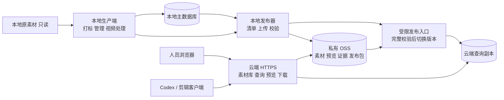

# 本地打标与阿里云查询下载方案

2026-11-09。用户已明确：打标留在本地，素材查询下载部署到阿里云；已有服务器和 OSS。本文为工程划分与部署的拟定方案，尚未实施云端改造、连接服务器或上传数据。服务器系统、资源配置、Bucket 地域及访问入口待部署阶段核对。

## 工程划分

推荐保留当前一个 Git 仓库，提供两个独立部署端及一个本地发布组件。两端分别启动、安装依赖、配置凭证和升级；共用契约与基础库，不要求服务器安装整套本地模型环境。当前先按模块拆分，不另建两个独立演进的代码仓库。

| 部分 | 部署位置 | 职责 |
| --- | --- | --- |
| 本地生产端 | 当前 Windows 电脑 | 导入、技术提取、OCR/人脸/CLIP/Qwen 初稿、人工修订、视频处理、主数据库、表格导出 |
| 发布组件 | 本地生产端 | 生成变更清单，上传素材/预览/证据与索引发布包，校验并记录云端采用状态；重试复用已上传内容 |
| 云端查询端 | 已有阿里云服务器 | 登录、画廊/列表、搜索筛选、详情、预览、固定版本下载、现有 HTTP/MCP 客户端访问 |
| 云端对象存储 | 已有 OSS Bucket 的专用前缀，按私有访问部署 | 素材副本、预览、必要证据、不可变索引发布包；不改变本地原件 |
| 共用模块 | 同一仓库，两端分别打包 | 素材 ID/SHA256、字段/词表版本、权限和隐私规则、查询/下载契约、存储接口、发布清单 Schema |

拟定的代码边界为“共用库、本地应用入口、云端应用入口、本地发布器”，优先复用现有 `catalog`、`contracts`、`search`、`files`、`storage` 等模块。目录名与新命令在实现时确定；这些组件名称不是已经存在的部署命令。

一个仓库便于让素材 ID、AI/人工状态、权限和下载版本同时升级，减少两套实现的契约漂移。两个独立部署端则让 GPU/模型故障、重启或本地关机不影响云端已经发布的数据。只有未来出现独立团队、独立产品和长期不同发布节奏时，再评估拆仓库。

## 数据流与界面

本地保留当前管理和处理页面，增加发布状态。云端首版只展示素材库、搜索、预览和下载；隐藏并在服务端禁止上传入库、打标调度、视频处理、标签修改和词表发布等业务写操作。登录、审计及部署状态独立保存，不能写回素材主数据。

本地 SQLite 是唯一业务写入源，云端保存已采用的查询版本。首版采用“按批次发布一致快照、文件按哈希增量上传”，适合当前已处理的 415 张图片；后续量级增加再评估增量索引。它不需要双向数据库同步，也不把运行中的 SQLite/WAL 文件直接复制上云。

云端部署不运行素材打标 Worker。已有文字/视觉查询若需要 BGE 或 CLIP 查询编码，可独立配备固定版本的 CPU 查询组件；该步骤只编码搜索词，素材向量仍由本地生成。不具备对应组件时明确报告能力不可用，不能让同一请求悄悄变成效果不同的查询；不在请求期间下载模型。首版具体启用哪些搜索能力，在实现前按现有检索契约确定。

## 素材和索引一起发布

上传内容必须同时覆盖文件与检索数据。仅有 OSS 素材无法提供当前的标签查询，只有表格也不足以复现当前候选证据校验。

1. 本地生成发布清单：选定素材与版本、来源、AI 初稿和人工有效值、字段状态、可见账号、隐私复核、词表/索引版本，以及所有文件的 SHA256/大小。原件、衍生版、复核输出及必要来源链必须对应同一版本。
2. 先上传清单引用的新增素材、预览与必要报告/帧。对象使用内容寻址和专用前缀，已有内容校验后复用，失败重试不覆盖其他业务对象，不删除本地来源。
3. 从一致快照构建可移植查询包，保留必要的任务/证据绑定与权限关系；剔除本机凭证、会话、无关账号、运行日志和未选素材。按类型重定位路径，不对整库文本做盘符替换。
4. 云端下载到暂存版本，完整检查数据库关系、模板指纹、词表/索引配对和所引用文件的实际哈希。任一依赖缺失或损坏则拒绝采用，继续提供上一个完整版本。
5. 通过受限发布通道原子切换当前版本；每个查询/传输绑定实际采用版本，保留旧版本到其在途请求结束。本地收到采用回执才显示“云端已发布”。

发布包必须带版本、父版本、清单摘要和兼容范围；对象存在或上传进程退出成功均不等于发布成功。初稿上云仍标识 AI 初稿、许可未核实，医学字段不凭发布过程自动确认。原模板保持本地契约；云端若需要模板校验，应单独授权传递并核对摘要，不提交 Git。

当前离线备份会保存完整业务状态，要求停止服务/Worker，且可能含会话哈希；它可作为维护恢复依据，不能直接当作面向云端查询的发布包，也不能宣称现有备份工具支持在线发布。

## 访问与持续服务

复用已有 OSS，按私有访问方案部署；先核对 Bucket/对象 ACL 与策略，使用项目专用前缀，不擅改共享 Bucket 配置。阿里云官方支持通过 ECS 代理访问私有 OSS，以及由服务生成临时签名链接两种路径，见[私有资源访问方案](https://www.alibabacloud.com/help/en/oss/how-to-apply-the-private-permission-to-the-actual-business)。

首版推荐继续走受授权的稳定 API 下载，由云端服务读取 OSS，复用现有 Range、ETag、固定哈希及传输中权限检查；性能和出网路径需实测。后续若切换客户端直连 OSS，必须另行处理签名有效期内的撤权窗口，不在表格里保存临时签名 URL。

云端配置独立的 reader 身份，映射至原稳定 actor ID 和明确素材权限；不复制本机长期 token 或把公网来访者当作本机 owner。查询服务只需已发布对象的读权限；本地发布身份单独授予专用前缀的必要写权限。ECS 可采用实例 RAM 角色与临时凭证自动刷新，见[阿里云 Python SDK 凭证说明](https://www.alibabacloud.com/help/en/oss/developer-reference/2-0-manual-preview-version/)。最终凭证方式依实际服务器类型配置。

本地关机时，云端可查询最后一个完整发布版本；新素材和新标签待下次发布后可见。涉及权限/隐私收紧时，先使云端限制生效并取得回执，再记录撤权已同步。拟定保留独立于内容快照的云端拒绝记录，旧版本回退不得恢复已撤销的访问；配置权限同步新鲜度上限，超期时限制相应文件访问。断网期间明确标识“撤权尚未同步”，不能承诺离线本地修改会立即影响云端。

## 改造顺序与验收

| 顺序 | 关联任务 | 拟定工作及出口 |
| --- | --- | --- |
| 1 | D01/D07/D17 | 分离云端启动入口和依赖；不执行队列恢复/上传派发/投影写入。独立样例查询服务可在无 GPU/无打标权重环境启动，业务写路由拒绝 |
| 2 | D08 OSS / D01 | 实现私有 OSS 后端、受校验读取/缓存、内容寻址上传和重试；完整性/权限失败不回退其他版本或未打码原件 |
| 3 | D08 OSS / D15/D17 | 实现发布清单、可移植查询包、依赖闭包、云端校验/切换/回执和撤权控制；故障注入证明失败保旧、回退不恢复撤权 |
| 4 | D07/D12/D17 | 结合实际服务器系统提供常驻运行、HTTPS、云端只读素材库、独立账号和备份恢复；核对 OSS 前缀及网络路径 |
| 5 | D18/D20 | 首批真实素材完整发布；本地与云端候选/状态/权限对照，实际预览和 Range 下载校验；本地停机后查询下载继续可用 |

另验重复发布无新增业务记录、缺帧/坏报告拒绝切换、发布中本地修订不混入旧版、云端拒绝越权访问/写操作、隐私撤回复核及旧清单失效。正式负载/P95、医学和完整视听业务继续分别验收。既有客户端支持 HTTPS origin；只有云端真实通过后，才配置客户端指向新入口，不提前改相邻剪辑工程。

当前实现仍是本地完整服务：`storage/oss.py` 为报错占位；`api/config.py` 会初始化 Router、恢复队列和派发上传，不能直接作为云端只读启动器；`drafts`/`files` 仍依赖本地报告与帧。上述改造和云端实际验收尚未完成。D08 的 OSS 子项提前进入当前主线，飞书继续后置；不新增任务完成数。
