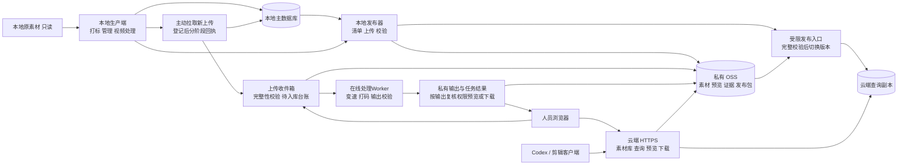

# 本地打标与阿里云查询下载方案

2026-11-09。用户已明确：本地打标、阿里云查询下载；已有8GB内存服务器和OSS；多人上传需入本地库并区分新增/重复；用户要在当次使用中取得处理结果，不能等待本地打标入库。本文为拟定方案，尚未实施云端改造、连接服务器或上传数据。系统、CPU/磁盘、Bucket地域、素材规格/并发及可接受等待时间待核对。

## 工程划分

企业入口补充：用户要求接现有企业网站与账户，技术栈Python/Vue。人员页面由企业Vue承载，企业Python复用现有登录后向素材服务提供受信身份；素材API、收件/在线Worker、本地后台保持当前分工。优先同域API集成，具体身份协议及项目待取得；见[企业接入方案](enterprise-integration.md)，尚未实施，不另给员工分发本地长期token。

推荐保留当前一个 Git 仓库，提供两个独立部署端及一个本地发布组件。两端分别启动、安装依赖、配置凭证和升级；共用契约与基础库，不要求服务器安装整套本地模型环境。当前先按模块拆分，不另建两个独立演进的代码仓库。

| 部分 | 部署位置 | 职责 |
| --- | --- | --- |
| 本地生产端 | 当前 Windows 电脑 | 导入、拉取云端待入库上传、主库判重/登记、技术提取、AI初稿、人工修订、视频处理、表格导出 |
| 发布组件 | 本地生产端 | 生成变更清单，上传素材/预览/证据与索引发布包，校验并记录云端采用状态；重试复用已上传内容 |
| 云端查询与收件端 | 已有阿里云8GB服务器 | 登录、素材库查询/预览/下载、HTTP/MCP访问；受限人员投稿、待入库台账和状态查询 |
| 在线处理Worker | 持续在线的云端执行节点；是否与8GB服务器同机待实测 | 仅运行用户要求的变速/打码等处理，结果直接回到本次任务；与查询进程、后台打标分开限资源 |
| 云端对象存储 | 已有 OSS Bucket 的专用前缀，按私有访问部署 | 素材副本、预览、必要证据、不可变索引发布包；不改变本地原件 |
| 共用模块 | 同一仓库，两端分别打包 | 素材 ID/SHA256、字段/词表版本、权限和隐私规则、查询/下载契约、存储接口、发布清单 Schema |

拟定的代码边界为“共用库、本地应用入口、云端应用入口、本地发布器”，优先复用现有 `catalog`、`contracts`、`search`、`files`、`storage` 等模块。目录名与新命令在实现时确定；这些组件名称不是已经存在的部署命令。

一个仓库便于让素材 ID、AI/人工状态、权限和下载版本同时升级，减少两套实现的契约漂移。两个独立部署端则让 GPU/模型故障、重启或本地关机不影响云端已经发布的数据。只有未来出现独立团队、独立产品和长期不同发布节奏时，再评估拆仓库。

## 数据流与界面

本地保留管理和处理页面，增加云端待入库与发布状态。云端提供素材库、受限投稿及在线处理入口，管理端查看“待入库”。云端收件/处理任务状态与已发布目录分开存储；在线Worker可生成私有处理结果，不修改正式标签或词表。收件、处理输出/复核、登录和审计不能随查询快照切换/回退而丢失或恢复已撤销权限。

本地SQLite是正式素材目录/标签的唯一写入源；云端独立保存收件和在线处理任务，实际输出带不可变源/结果hash及配方，随后导入本地并保留原生产者与复核记录。输入走“云端收件/结果→本地登记”，目录发布走“本地索引→云端查询”，不做双向主库同步。首版按批次发布一致快照、文件按hash增量上传，不直接复制运行中的SQLite/WAL。

云端部署不运行素材打标 Worker。已有文字/视觉查询若需要 BGE 或 CLIP 查询编码，可独立配备固定版本的 CPU 查询组件；该步骤只编码搜索词，素材向量仍由本地生成。不具备对应组件时明确报告能力不可用，不能让同一请求悄悄变成效果不同的查询；不在请求期间下载模型。首版具体启用哪些搜索能力，在实现前按现有检索契约确定。

## 当次处理返回与后台入库分开

用户取结果走在线链路：上传完成/完整性校验→有界处理队列→在线Worker执行所需打码/变速→完整输出校验与登记→私有预览及按现有门槛下载。页面在当次任务中显示进度、失败及结果；后台可用异步任务接口，不能把排到下一次本地开机当作满足需求。处理不等待OCR、CLIP/Qwen标签、医学字段确认或云端目录发布。

后台入库独立执行：已完成上传及实际处理输出→待入库台账→本地拉取/判重/登记→打标→发布索引。用户先取得有权使用的处理结果，本地离线只延迟此后台链路；不能延迟在线处理Worker。重复处理只在源hash、配方/软件版本、输出hash、权限及当前复核均有效时复用，不按文件名或历史“成功”状态直接返回。

打码输出仍按既有规则提供给有权复核者私有预览，人工复核绑定实际输出hash后才能经已处理入口下载/共享；不让医学标签审核阻断技术处理，也不跳过隐私输出复核。外部上传者声称已打码不能代替实际链路。现有核心主要验证视频打码/变速；图片具体处理操作和格式需进一步确认，不能把视频核心计作图片入口已完成。

8GB仅是内存信息，不能推出响应时间。拟定先在实际服务器以独立CPU处理进程、受控编码线程和单个处理并发测试，限制输入像素/帧数/时长、临时盘及总任务预算；处理时同时测查询延迟、峰值内存/CPU、磁盘和用户等待时间。同机不达门槛时，将处理Worker迁到独立常在线云节点或采用按任务扩容，现有8GB服务器继续服务网站/查询。具体规格、并发与耗时未测，不承诺秒级、实时视频或任意长片；无需在验证前认定必须购买GPU。

在线处理部署属于本轮D07/D09/D10/D11/D12适配及真实验收。现有本地核心不能直接视为已通过Linux/8GB云端运行、同机资源隔离和用户等待时延验证。仅在本地常开且可达时用本机作为在线节点属于另一种可用性选择，不能把它作为“本地可关机仍当次取结果”的默认保障。

## 多人上传与新素材判定

拟定管理页提供“待入库”收件箱，展示上传人/时间、文件名/大小、实际核验SHA256、判重依据、对应库内ID（有权时）、本地登记/打标/发布阶段和失败原因；显示待处理、新文件、重复及失败计数。无需管理员到OSS按文件名或修改时间找新增。

| 情况 | 判定与处置 |
| --- | --- |
| 同一上传请求重试 | 返回原上传ID和状态，同键不同输入拒绝；不重复登记或派发 |
| SHA256与大小相同，改名再上传 | 文件字节重复；复用物理对象，保留上传人/来源。是否新增目录记录依来源、账号和权限判断，不自动合并授权或覆盖标签 |
| 本地主库不存在此内容 | 新文件，校验后自动登记为AI初稿并派发分析，不补造许可或审核 |
| 已有私有工作文件，尚未加入素材库 | 显示“已有文件、待入库”；物理对象存在不代表已对团队发布 |
| 系统登记的打码/变速输出 | 按真实配方和父版本关联为衍生素材，新输出hash独立，保留隐私复核门槛 |
| 外部重压缩/裁剪/剪辑后hash不同 | 不同文件；SHA不能证明画面是否全新。首版保留此限制；若另做相似比对，仅提示疑似，不自动合并/删除或认定来源 |

云端只参考已发布索引及收件记录初判，并显示索引版本；无匹配时显示“待本地主库确认”。最终判重/登记由本地主库事务完成，不能因云端索引落后而宣称全库不存在。归档/未公开记录也可能命中，只有有权管理人能看到；上传者仅见本人回执及有权匹配详情，不能用hash探测其他账号私有素材。

拟定同步流程：

1. 云端鉴权后创建上传ID，记录上传人/时间及声明来源，分块或流式保存到受限OSS收件前缀；服务端核验完整实际字节、SHA256和大小，完成前不进待拉取队列。浏览器hash仅作声明，不能用它引用他人对象、跳过所有权验证或取得下载权限。
2. 本地同步进程主动通过HTTPS拉取已完成收件清单，以不可变事件序号/上传ID和持久化游标取待办；下载后复验hash并校验媒体。无需公网直连本机，不以文件mtime作为唯一依据。
3. 在本地事务中绑定上传ID与素材/来源/分析事件。新内容为AI初稿；相同字节仍保留来源/账号边界，仅在输入、规则/模型版本和权限均满足时复用成功阶段。重复事件不新增登记或作业。
4. 提交成功后回执“已登记”及稳定ID；打标完成、索引发布、云端采用分别回执。下载完成不等于入库；本地提交后、回执前断网也必须支持幂等恢复。
5. 发布时引用已校验且有权采用的OSS对象，避免相同原件再传一份；新来源/许可/输出不覆盖旧记录。云端采用后才按原权限进入查询库，状态仍区分AI初稿、医学确认和隐私复核。

本地关机时，云端仍接收投稿，在线处理节点继续执行并返回结果；入库支线显示“等待本地入库”，已有发布库继续查询下载。新上传和未发布输出默认仅上传者及获授权管理/复核人可见，不自动进入团队搜索。云机按限额流式收件，不运行语义打标重任务；上传/处理配额须实测。

现有代码已实现SHA256物理去重、请求幂等及来源/权限分别登记；相同字节的不同上传请求/账号仍可有独立asset记录。云端收件台账、本地拉取桥接、新素材判定管理页及分阶段回执均尚未实现。

## 素材和索引一起发布

上传内容必须同时覆盖文件与检索数据。仅有 OSS 素材无法提供当前的标签查询，只有表格也不足以复现当前候选证据校验。

1. 本地生成发布清单：选定素材与版本、来源、AI 初稿和人工有效值、字段状态、可见账号、隐私复核、词表/索引版本，以及所有文件的 SHA256/大小。原件、衍生版、复核输出及必要来源链必须对应同一版本。
2. 先上传清单引用的新增素材、预览与必要报告/帧。对象使用内容寻址和专用前缀，已有内容校验后复用，失败重试不覆盖其他业务对象，不删除本地来源。
3. 从一致快照构建可移植查询包，保留必要的任务/证据绑定与权限关系；剔除本机凭证、会话、无关账号、运行日志和未选素材。按类型重定位路径，不对整库文本做盘符替换。
4. 云端下载到暂存版本，完整检查数据库关系、模板指纹、词表/索引配对和所引用文件的实际哈希。任一依赖缺失或损坏则拒绝采用，继续提供上一个完整版本。
5. 通过受限发布通道原子切换当前版本；每个查询/传输绑定实际采用版本，保留旧版本到其在途请求结束。本地收到采用回执才显示“云端已发布”。

发布包必须带版本、父版本、清单摘要和兼容范围；对象存在或上传进程退出成功均不等于发布成功。初稿上云仍标识 AI 初稿、许可未核实，医学字段不凭发布过程自动确认。原模板保持本地契约；云端若需要模板校验，应单独授权传递并核对摘要，不提交 Git。

当前离线备份会保存完整业务状态，要求停止服务/Worker，且可能含会话哈希；它可作为维护恢复依据，不能直接当作面向云端查询的发布包，也不能宣称现有备份工具支持在线发布。

## 访问与持续服务

复用已有 OSS，按私有访问方案部署；先核对 Bucket/对象 ACL 与策略，使用项目专用前缀，不擅改共享 Bucket 配置。阿里云官方支持通过 ECS 代理访问私有 OSS，以及由服务生成临时签名链接两种路径，见[私有资源访问方案](https://www.alibabacloud.com/help/en/oss/how-to-apply-the-private-permission-to-the-actual-business)。

首版推荐继续走受授权的稳定 API 下载，由云端服务读取 OSS，复用现有 Range、ETag、固定哈希及传输中权限检查；性能和出网路径需实测。后续若切换客户端直连 OSS，必须另行处理签名有效期内的撤权窗口，不在表格里保存临时签名 URL。

云端配置独立reader身份，映射至稳定actor ID和明确素材权限；投稿需另授上传能力，收件管理/本地拉取身份分开。不复制本机长期token或把公网来访者当作本机owner。查询服务只读发布对象，收件写权限限收件前缀，本地发布身份另限发布前缀。ECS可采用实例RAM角色和临时凭证自动刷新，见[阿里云Python SDK凭证说明](https://www.alibabacloud.com/help/en/oss/developer-reference/2-0-manual-preview-version/)。最终方式依服务器类型配置。

在线处理Worker只读取本次已授权源版本并写独立任务输出前缀；实际输出hash、配方、生产者、源时钟和复核记录进入处理回执，导入本地时重验，不把云端随意填入的“已处理”标志当成可信证据。下载和来源权限不因字节相同而扩大。

本地关机时，云端可查询最后一个完整发布版本；新素材和新标签待下次发布后可见。涉及权限/隐私收紧时，先使云端限制生效并取得回执，再记录撤权已同步。拟定保留独立于内容快照的云端拒绝记录，旧版本回退不得恢复已撤销的访问；配置权限同步新鲜度上限，超期时限制相应文件访问。断网期间明确标识“撤权尚未同步”，不能承诺离线本地修改会立即影响云端。

## 改造顺序与验收

| 顺序 | 关联任务 | 拟定工作及出口 |
| --- | --- | --- |
| 1 | D01/D07/D17 | 分离云端启动入口和依赖；查询目录不执行队列恢复/上传派发/投影写入。无GPU/无打标权重环境可启动，仅允许独立收件等运行状态写入 |
| 2 | D08 OSS / D01 | 实现私有 OSS 后端、受校验读取/缓存、内容寻址上传和重试；完整性/权限失败不回退其他版本或未打码原件 |
| 3 | D08 OSS / D15/D17 | 实现发布清单、可移植查询包、依赖闭包、云端校验/切换/回执和撤权控制；故障注入证明失败保旧、回退不恢复撤权 |
| 追加输入链路 | D01/D03/D09/D12 | 云端收件箱、字节核验/精确判重、本地拉取/幂等登记、分阶段回执及管理页；快照回退不覆盖待办 |
| 在线结果链路 | D07/D09/D10/D11/D12 | 常在线处理Worker、任务页面、源/配方/输出hash及隐私复核；8GB同机单任务与查询并行实测，不达门槛再独立执行节点 |
| 4 | D07/D12/D17 | 按实际系统提供常驻运行、HTTPS、云端查询/收件、独立账号及分别备份恢复；核对OSS前缀/网络路径 |
| 5 | D18/D20 | 首批真实素材完整发布；本地与云端候选/状态/权限对照，实际预览和 Range 下载校验；本地停机后查询下载继续可用 |

另验重复发布无新增业务记录、缺帧/坏报告拒绝切换、发布中本地修订不混入旧版、拒绝越权访问/写操作、隐私撤回及旧清单失效。收件另验改名同文件、同名不同文件、多人同文件且来源/权限不同、已有未入库、未完成上传、伪报hash、同时上传、重复拉取、提交后丢回执、本地离线/重连、云端索引落后和收件/发布回退隔离。正式负载/P95、医学和完整视听业务继续分别验收；疑似相似不算精确判重证据。既有客户端支持HTTPS origin，云端真实通过后才配置新入口，不提前改相邻剪辑工程。

当前实现仍是本地完整服务：`storage/oss.py` 为报错占位；`api/config.py` 会初始化 Router、恢复队列和派发上传，不能直接作为云端只读启动器；`drafts`/`files` 仍依赖本地报告与帧。上述改造和云端实际验收尚未完成。D08 的 OSS 子项提前进入当前主线，飞书继续后置；不新增任务完成数。

在线链路另验本地停机仍能取处理结果、打标失败不阻断处理、处理与查询同机资源隔离、过载/取消/故障回收、实际等待时间、输出完整解码及hash、隐私撤回/未经复核不得下载。后台入库失败保留收件待办，不删除已经生成的私有结果。
