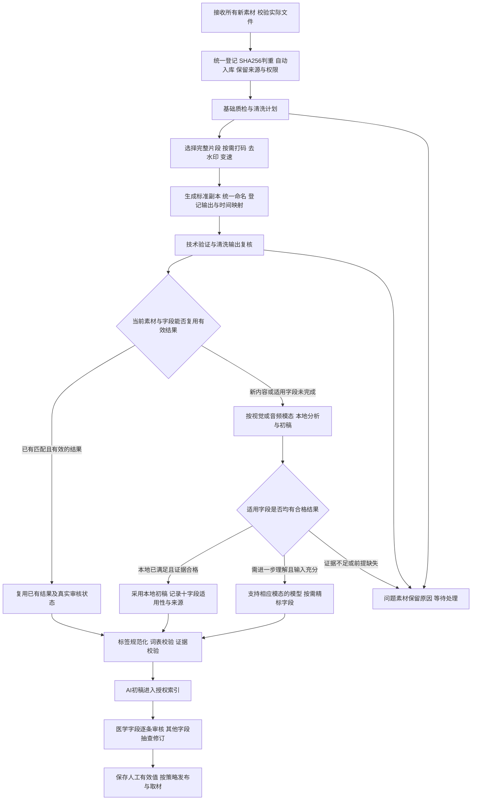

# 素材清洗、本地粗分类与十维度精细打标方案

日期：2026-11-11（Asia/Shanghai）。状态：**方案整理，尚未开始实现**。

本文汇总本轮讨论，供审阅和后续实施使用。只新增方案及总控文档入口，不修改程序、模型配置、素材、标签、原始模板或现有服务；不启动处理、部署或全库重跑。后续实施须另行明确开始。

## 1. 目标、已明确事项与建议默认值

目标是把来源不一的素材整理成可直接取用、可追溯的标准素材。**所有新增素材均须登记、判重、入库并进入打标流程**，包括生活场景、医学素材、贴纸、BGM、音效，以及为打码、去水印、变速而上传的素材。先由适合该模态的本地能力分析；本地不能满足的适用字段再升级精标或待人工。

原索引表“用途与主题”的10个字段作为统一表达框架，所有素材逐项评估适用性，不要求每项都有值，也不要求每份素材都调用更强模型。需要人工确认的字段进入审核，人工有效值与AI建议分别保存。上一版“仅处理、不要求语义入库即可不打标”的例外取消。

| 事项 | 本轮明确内容或方案建议 |
| --- | --- |
| 工作范围 | 所有新增素材的登记/判重/打标入库、清洗、本地分类、按需十字段精标、人工审核及索引衔接；本轮仅整理方案 |
| 素材覆盖 | 生活场景与医学素材，以及图片、视频、GIF/贴纸、BGM、音效、文献截图等均须打标；不因非医学或仅请求处理而免打标 |
| 清洗内容 | 基础质检、真人脸打码、水印去除/处理、视频时长与变速整理、统一文件名 |
| 视频长度 | 用户提出通常控制在3～5秒；**建议默认针对每个可用片段**，整条视频压缩到3～5秒作为显式可选模式，该默认建议仍供审阅 |
| 精标模型 | 具体更强模型及本地/外部API选择后置；不因写入方案而调用外部模型或升级本机模型 |
| 已有本地VLM | Qwen3-VL-2B可作为后续开发对照基线；现有四字段能力不等于已具备十字段精标能力 |
| 精标分流 | 只决定哪些适用字段需要进一步分析，不决定是否登记/判重/打标；区分阶段性本地初稿与十字段评估完成，不能凭单一模型分数免精标 |
| 原件与名称 | 来源原件只读；统一命名用于标准素材副本、导出名及展示名，保留原名映射 |
| 审核 | 医学四字段逐条确认；其余六字段人工抽查、可修订；输出隐私复核独立保留 |
| 表格 | 原素材索引35列、缺口表14列及锁定枚举不变；新处理状态和候选证据保存在内部记录/附加台账 |

已明确需求与建议默认值分开记录，不把建议写成已经运行的规则。

## 2. 完整流程与各阶段的先后关系

这是拟定的正式标准素材路线。原件登记不等于清洗或审核完成；可以先登记、后处理，失败时仍有台账。为规划切镜、选择完整动作及定位人脸/水印而做的预分析属于清洗准备，不算十字段精标完成。

清洗后的实际输出通过验证后，复用或生成绑定该版本的本地结果，并根据字段适用性、证据和本地质量决定是否精标。涉及真人脸的输出，在通过绑定实际输出哈希的隐私复核前，不开放普通“已处理副本”预览、下载或下游发布。可以保存任务状态和私有待审记录，不把它们显示为可直接取用素材。

标签审核后置不阻止已经满足文件权限/隐私门槛的非医学初稿入索引。文件可用、标签已确认、许可已核实、当前剪辑用途适合、最终医学审核通过分别记录。原有独立在线打码/变速入口仍按自身流程返回处理结果，不必等待本地打标；但所有新素材同步进入持久化收件/判重/后台打标链路，处理任务完成、用户离开页面或下载结果都不取消后台入库任务。

### 2.1 所有新增素材的判重与后台打标规则

| 判重结果 | 拟定处理 |
| --- | --- |
| 精确相同，且已有对应实际版本/片段的有效分析 | 复用内容与可用分析结果，核对10字段覆盖并补缺；仍记录本次上传、来源、账号和请求，不重复执行已合格的模型阶段 |
| 精确相同，但旧记录缺标签、失败、证据失效或版本不适用 | 复用物理内容，恢复/补齐缺失阶段，不把“重复文件”当作“打标完成” |
| 哈希不同、内容近似 | 只标记疑似重复并关联候选，仍登记和打标；不同裁剪、字幕、水印、配乐或片段范围可能影响语义 |
| 未发现重复 | 创建或关联合法素材身份，入库并自动排入该模态的打标流程 |
| 文件损坏或暂不支持 | 保留登记/错误及待处理状态，不虚构标签，也不从新素材台账中消失 |

云端已发布查询索引只供初判，本地主库对实际SHA256作最终精确判重。图片/视频感知特征或音频声学指纹可在后续实现中辅助找近似项，不代替精确身份，也不直接删除/合并记录。跨来源、跨账号的内容复用不自动转移所有权、权限、来源许可或人工批准，分析结果须满足对应授权及证据绑定。

清洗新生成的副本、片段和音频版本也登记实际输出哈希及衍生关系，复核哪些字段可有据复用、哪些必须重新分析；不能仅因“同一原件”就自动复制全部标签。只修改展示名且内容/范围不变时，可复用已有有效分析。

## 3. 素材清洗：先整理画面与时长，再做正式打标

### 3.1 基础质检、判重与分析副本

接收时检查实际字节、格式、可解析性和文件哈希，登记分辨率、方向、时长、帧率/时间基准、音轨和透明信息。图片检查可解码性，视频检查视音频流及实际解码结果；具体预算和全片校验范围在实施验收时冻结。

- SHA256完全重复的文件复用物理内容，但保留每次来源、账号归属和权限；不同来源不因同字节自动合并授权。
- 感知相似或内容近似只产生“疑似重复”关系，不自动删除、覆盖或合并素材。
- 黑帧、空白、模糊、低分辨率、遮挡、明显压缩损伤、字幕/标注、水印等分别标记；低质量不自动等于无使用价值。
- 损坏或无法解析的文件保留错误原因，暂停依赖它的处理和视觉模型阶段，不伪造成功结果。
- 按需生成方向正确、尺寸受控的缩略图、证据帧、代理或标准副本。保留原比例、重要上下文和透明信息；不默认拉伸、裁去医学标注、放大补细节或强制所有输入反复转码。

水印检测、可见文字识别和人脸检测是清洗依据，不分别等同于已经去水印、已经理解医学标注或已经完成人脸打码。

### 3.2 真人脸打码

建议对清洗计划中需要脱敏的真人脸执行检测、连续跟踪、遮挡/侧脸风险检查及打码；默认处理范围建议覆盖该输出中的全部真人脸，具体掩码与例外由清洗计划明确。人物身份识别不在本方案范围。

视频必须检查实际输出的连续画面，不能用几张抽帧判定全片打码完成。复核时支持定位漏码、补框和重渲染。图片与视频分别验收；已有D10视频核心不代表静态图片清洗入口已实现。

打码批准绑定输出SHA256、处理配方和复核人。后续裁剪、去水印、变速或重新编码导致输出字节变化时，新的最终输出重新走隐私复核；旧批准不自动沿用。处理失败或未批准时，不从已处理副本入口回退原件。

### 3.3 水印去除与画面修复

水印去除纳入清洗，但按素材单独决定处理方式：可在不丢失主体和必要上下文时裁剪边缘水印，或采用局部遮挡/修复。具体算法和模型后置选择；本方案不承诺自动无痕恢复。

每份素材保存水印区域、处理方式、源/输出哈希及结果复核。检查残留、闪烁、涂抹、错误补画、文字或关键结构损伤。无法可靠处理时，记录“无法可靠去除/需人工处理”，保留原件和候选副本，不显示为去水印成功。

生成式修复区域不能作为新增医学事实的证据。对涉及解剖结构、病变表现或重要文字的修复，必须核对实际保留的内容，必要时换用其他素材。去水印不改写来源、许可和署名记录，也不把“许可未核实”改为已核实。

### 3.4 视频整理为3～5秒可用片段

**建议默认：先选择内容完整的可用片段，再按需变速，让每个标准视频片段通常落在3～5秒。** 这不是把所有长视频整体强压成几秒，也不是严格每隔4秒切一刀。

| 输入情况 | 建议处理 |
| --- | --- |
| 已在3～5秒，内容完整且节奏合适 | 保持1.0倍速 |
| 长视频有多个场景或动作 | 按场景与动作完整性提出候选区间，分别生成片段，优先1.0倍速 |
| 稍长但完整的单个动画/动作 | 可选择目标时长后计算倍速；例如6秒到4秒为1.5倍速，仍需观看结果 |
| 短于3秒 | 标记短片段，按内容决定保留或显式慢放；不默认拉长、循环或补帧 |
| 完整过程无法合理压到3～5秒 | 作为例外保留较长版本并记录原因，或交人工选择区间，不截断关键过程 |
| 用户明确选择整条压缩模式 | 按完整输入和目标时长计算速度，超出支持范围或可用性要求时报告需调整，不静默强压 |

选定源区间长度为D、目标时长为T时，倍速为D/T。目标首先是3～5秒区间；只有确需精确时长时才选择具体T，可建议以4秒为起点，不默认把所有片段变为4秒。

所有区间基于登记的源时间基准，保存源起止、输出起止、倍速、输入/输出哈希及时间映射。重新请求从登记基准计算，不叠加对已变速输出的处理。未指定倍速或目标时长时保持1.0。

音频策略需要明确记录。建议清洗预设提供“保留并同步变速、尽量保持音调”和“去除原声”两个选项；正式默认值、含对白素材与多音轨选择规则在实施前确认，不在本轮改变现有配置。禁止在未注明时让对白异常加速或静默换音轨。

打码、水印处理和变速尽量在兼容的同一渲染计划中组合，减少有损重复编码；具体执行顺序、坐标映射和编码组合需验证，不能仅凭方案宣称已能一次编码。复核针对最终输出，不能以中间输出的批准替代。

### 3.5 统一文件名

建议标准副本采用稳定规则：`素材ID_片段号_版本号.扩展名`。例如 `M0123_S003_V002.mp4` 仅作命名示例，不代表现有素材。

原件保留原名；映射记录包括原始名称、素材ID、片段ID、版本、标准名称和文件哈希。身份与权限依赖ID/哈希，不依赖文件名。中文主体短语可作为独立展示标题，避免模型改标签后反复改存储文件名。

统一命名放在清洗输出登记时执行；名称不写未经验证的“已审核/已打码”结论，处理和批准状态读取台账。相同命名规则重复执行须幂等，冲突时使用稳定片段/版本标识，不覆盖已有文件。仅改展示名不改变文件内容哈希；重新渲染则产生新输出哈希。

### 3.6 贴纸、BGM与音效的清洗适用范围

贴纸保留实际透明通道、边缘和动画循环特征；静态贴纸与动态贴纸分别探测。不能为统一格式把透明贴纸变成不透明图片，或只截首帧就宣称完成动画内容分析。涉及真人脸或水印时，再按对应处理和复核规则生成副本。

BGM和音效检查实际音频是否可解码、时长、音轨/声道以及静音、截断、爆音等质量问题，记录真实结果。视频3～5秒目标不直接套用于音乐、音效或GIF/动画贴纸；不为统一长度默认截断旋律、循环或完整声音事件。若明确要导出短音频或把动画导出成标准视频片段，再按对应用途另定区间和配方。

音频响度调整、去噪、剪静音或重新编码如后续需要，单独作为有记录的处理选项，不在本轮默认执行。音频/贴纸统一命名同样保留原名、格式、哈希及来源，不以文件名作为声音或画面内容的证据。

## 4. 本地粗分类与精标分流

优先复用已有固定版本Chinese-CLIP及其图像表示，结合本地候选文本进行粗分类；OCR和人脸观察作为各自独立的辅助信息。候选文本及规则另行版本化，不训练新模型作为首要前提。

视觉素材建议先按两个方向产生候选：素材的用途大类，以及实拍/插图/剖面等表现形式。范围沿用原契约与已发布选项，不擅自增加正式分类。贴纸也读取实际静态图像/动画；纯音频不送进图像分类器，必须另用实际音频内容完成分析，能力未接入时明确排入待音频打标。

粗分类输出少量排名候选及相似度，例如初始可试用途Top-3和形式Top-2；数量是待小批试验的建议值。相似度不是正确率，不能未经校准设定统一“超过某分数即正确”。保留未知、歧义及其他类别的可能性。

粗分类用于组织精标提示、候选词表和任务优先级，也参与判断本地结果是否足够。分流依据是统一10字段中哪些适用、是否已有合格证据及该模态本地能力是否经验证，不能只因粗分类第一名或分数高就跳过精标，更不能以素材属于生活场景、贴纸或音频为由不打标。进入精标时，模型必须读取实际视觉/音频证据，可以否定全部粗分类候选；两层结论冲突时保留冲突并提高复核优先级。

粗分类绑定实际分析文件、片段、帧哈希及模型/候选集版本。既有向量仅在文件、预处理和模型版本均匹配时复用；原件经过打码、去水印、裁剪等改变画面后，不能把原件向量冒作最终副本向量。

### 4.1 先区分“在哪里运行”和“标得多细”

“本地”指执行位置，“粗分类/精标”指分析深度，两者不是同一个维度。后续经验证的本地模型也可以承担部分精标；更强模型可能本地运行，也可能通过外部API调用。本文“升级精标”指增加必要的语义分析，不预设必须上云。

本地基础路径按模态协作：视觉采用技术工具、OCR、CLIP及必要时的小型VLM，音频需要经过实际验证的音频分析能力。CLIP排名本身不会生成完整画面描述，视觉VLM也不能因名称含“多模态”就视为可分析音频。当前四字段Worker仍保持已说明的实现边界，以下本地分流、新字段衔接及音频语义能力均属于待实现设计。

### 4.2 可以不调用更强精标模型的情况

| 情况 | 本地如何处理 | 可跳过精标的边界 |
| --- | --- | --- |
| 同一实际文件/片段已有完整且有效的标签或精标结果 | 核对内容、区间、证据、规则/词表及结果适用版本后复用 | 真实审核状态照原记录保留；同名、相似、同一来源或同一长视频不等于同一结果 |
| 同一内容只修改展示名称、存储位置或重新导出 | 用稳定ID/哈希验证内容与分析范围未变 | 不重新运行视觉模型，不转移原素材的权限、来源或人工批准 |
| 简单且含义明确的生活场景、背景、几何图形、普通物品、图标或贴纸 | 本地生成用途、主体/场景、形式及中英文检索词等适用初稿，并评估其余字段 | 本地已覆盖需要描述的内容且质量合格；不是少打标签，也不能仅凭文件夹名判定非医学或无需动作分析 |
| 固定模板或已核验素材系列，变化仅在受控非语义参数 | 按经过验证的模板规则提取变化项，复用不受影响的字段 | 模板身份、变化范围、规则和抽查通过；人物、文字、结构或动作变化不能自动沿用 |
| 文字清楚、含义简单的文字卡 | OCR提取原文，再用有据规则/本地模型补用途、主体和检索词等适用标签 | 只提取OCR不等于已打标；复杂图表、论文结论或医学含义仍需进一步分析 |
| BGM或音效的适用内容由本地音频能力可靠识别 | 分析实际声音，生成用途、内容/风格/情绪检索词等适用候选 | 必须有经验证的音频能力及覆盖依据；未配置音频模型不等于本地足够，不能凭封面/文件名判断 |
| 已有人工标签足够，或审核人直接依据实际画面确认了本地候选 | 复用有效值，仅处理缺失的适用字段 | 人工确认绑定当前版本/证据；医学四字段仍由对应权限人员逐项确认 |

所有新增素材都进入统一十字段适用性评估，不再保留“仅处理即可免打标”或“生活场景仅归大类即可结束”的路径。本地足够仅表示适用标签已经能由本地能力提供，不需要额外调用更强模型。简单类别也是候选判断；存在人体结构、专业标注、动作关系等疑点时，不应用简单素材的免精标规则。

在本地质量尚未校准前，可优先严格匹配并复用成功结果；其他新内容先生成已有能力支持的初稿，缺失或不合格的适用字段明确待补/待精标。不能设置一个未经验证的相似度或模型自报置信度阈值，就把新素材自动判成十字段完整。

生活场景应描述实际人物/物体、环境、可见行为及中英文检索词，不能只填“生活情景”一个大类。例如实际连续画面为“人物在厨房切菜”，可记录人物、案板、蔬菜、厨房和切菜等有据内容；动作证据不足时不能补编。科室、器官、疾病等字段按实际适用性保留候选、未知或不适用，不从普通行为推断疾病。场景、动作等检索信息优先用现有主体/过程及检索词承载，不自行扩充原表头。

### 4.3 需要升级精标、或转人工核对的情况

| 触发条件 | 拟定处理 |
| --- | --- |
| 本地缺少统一10字段中需要填写的适用字段 | 只对缺失/不合格且适用的字段升级精标；已有合格字段保留其证据 |
| 新的器官/病变候选、医学机制或专业用途需要辨别 | 默认进入精标候选流程并保留医学逐项审核；若有真实审核人直接解决，可不额外调用更强模型 |
| 动作、前后变化、变化方向、对象关系影响检索 | 提供实际连续片段或充分多图证据后精标，缺视频证据不能让模型凭静帧猜 |
| 主体多、遮挡明显、图表/剖面复杂，基础标签不够区分 | 在可读证据范围内精标主体与关系等必要字段 |
| 本地候选歧义、跨字段冲突，或描述明显过于笼统 | 增加必要证据后精标；输出仍冲突则待人工，不按多数模型投票认定正确 |
| 实际检索反馈表明标签遗漏、误标，或用户要求补充 | 定位受影响素材与字段，按需精标/复核，不无条件全库重跑 |
| 本地免精标样本抽查出现系统性问题 | 复核相应类别/规则，暂停该类自动免精标，并列出受影响记录 |

需要更细粒度的时间定位或框选而当前十字段不足时，先明确扩展的内部证据范围，不擅自新增原35列表头。升级精标不能取消医学、隐私、来源或当前剪辑用途审核。

### 4.4 暂缓不等于本地足够

- 文件损坏、重要主体被遮挡或画质不足以辨认：先修复输入、补证据或人工判断。更强模型不能凭空恢复不可见事实。
- 只有单帧却要求变化过程：先取得连续片段；缺证据的字段保持未知，不能以多次模型调用替代观察。
- 缺正式词表：先保留候选，等待词表映射/发布；反复调用大模型不能解决选项未发布问题。其他适用字段可独立继续。
- 精标模型未配置、预算不足或任务排队：保持“待精标/延后”，可先展示已有本地初稿，但不能记成“无需精标”或完整完成。
- BGM/音效等纯音频尚无已验证音频语义能力：视觉阶段不适用，素材仍登记、判重、入库并处于待音频打标，不把绕过视觉模型算成音频已打标。
- 隐私输出未复核或对象访问门槛未满足：等待相应处理/审核，不能通过换模型或只生成本地标签绕过文件门槛。

### 4.5 按素材与字段记录分流结果

拟定顺序是：统一接收、登记和判重，检查已有可复用结果，按实际模态完成清洗/分析与10字段适用性评估；对仍缺证据或不满足质量的适用字段决定升级精标或待人工。整份素材可同时包含“主体本地完成、医学候选待精标、情绪不适用”等不同字段状态。

每条分流记录保存模态、判重/复用依据、10字段适用性、字段覆盖/待办、证据和规则版本、决定时间及后续升级历史；处理任务状态与打标状态分别记录。结果分别展示：

| 结果 | 对外说明 |
| --- | --- |
| 处理完成、打标待办 | 清洗输出可按已有门槛交付，后台打标继续；不是免打标的终态 |
| 本地阶段初稿 | 已有部分初稿可检索，仍显示未覆盖或待补的适用字段，不算全项完成 |
| 本地完整初稿 | 10项均完成适用性评估，所需适用字段均有合格本地结果；不等于人工确认 |
| 复用已有结果 | 注明复用依据，沿用真实初稿/审核状态 |
| 待精标/待人工 | 明示待处理原因和字段，允许已合格部分继续使用 |
| 精标初稿 | 已完成实际调用及校验，保留人工审核要求 |

字段值仍使用第6节的既有状态；没有执行且不满足完成条件的分析，以流程待办单独记录，不伪装成not_applicable。是否继续精标取决于适用字段是否已满足证据与质量要求；“尚待确认的医学标签”也不能被“本地完整初稿”状态自动批准。

## 5. 多模态精标：覆盖“用途与主题”全部10字段

10个维度保持统一，字段可以由有效历史结果、本地分析或升级精标提供，不要求每个素材都让更强模型重做全部10项。进入精标时，按模态提供实际授权的标准图片、连续视频/动画片段或实际音频，以及必要细节、时间范围、粗分类候选和已发布字段选项；按需补齐或纠正适用字段，保留其他字段的证据与来源。文件名、目录名、音频封面和已有标题不能代替实际内容证据；画面/OCR文字作为内容读取，不能成为模型执行指令。

| 字段 | 拟生成的初稿 | 证据与约束 | 审核 |
| --- | --- | --- | --- |
| 用途大类 | 该素材主要适合的内容用途，包括生活情景、贴纸、BGM、音效等 | 从原契约/已发布选项中选；文献或图表外观不证明内容可靠 | 人工抽查 |
| 科室 | 与画面有依据关联的科室候选 | 从已发布词表选；不根据文件名或猜测诊断补科室 | 逐条人工确认 |
| 器官/系统 | 可见器官、组织或系统候选 | 绑定可见结构与已发布选项，不确定时保留歧义 | 逐条人工确认 |
| 疾病/症状 | 有实际证据支持的医学分类候选 | 不凭颜色、器官名称或单个动作诊断；OCR原文不直接变医学事实 | 逐条人工确认 |
| 画面主体 | 主要人物、物体、组织结构及场景等短语 | 描述实际画面；纯音频记不适用，声音内容另存内部描述/检索词，不改写原字段含义 | 人工抽查 |
| 过程/状态 | 可见状态或有连续证据的变化过程 | 动态及变化方向必须读取连续片段；静态抽帧不足时留空 | 逐条人工确认 |
| 表现形式 | 主要视觉呈现方式 | 严格沿用原六项；静态3D风格不证明发生了动画或运动；纯音频记不适用 | 人工抽查 |
| 中文检索词 | 实际主体、场景、动作、贴纸含义，或实际音乐/声音内容的中文短语 | 去重，保留否定/部位/方向；音频词来自实际声音，不自动发布医学别名或同义映射 | 人工抽查 |
| 英文检索词 | 对应的英文检索短语 | 与实际视觉/音频内容及中文含义一致，不擅加诊断或动作 | 人工抽查 |
| 情绪/语气 | 适用素材的语气候选 | 按原契约主要用于BGM/音效/贴纸；不能听取音频时不推断听觉情绪，普通图像可不适用 | 人工抽查 |

“十字段初稿完成”指10项均有适用性评估及状态，需要分析的适用字段已完成相应分析，不表示10项全部填有值。“本地阶段初稿”不自动计作这一完成状态；仅有unknown/no_match且关键需求尚未解决时，继续显示待办。不得为完成率给普通图片默认填“中性”，也不得为了填过程字段编造变化。

### 5.1 不同素材类型都打标，证据与重点分别处理

| 素材类型 | 必须关注的实际内容 | 标签表达与证据边界 |
| --- | --- | --- |
| 生活场景图片/视频 | 人物/物体、环境、可见动作及关系、主要用途 | 在用途、主体/过程和检索词等适用字段形成初稿；动态行为依赖连续画面，不从生活行为推断疾病 |
| 医学图片/视频/文献截图 | 结构、标注、机制/过程及可支持的专业候选 | 医学四字段保持逐条人工确认；图文和实际片段证据分别保留 |
| 静态/动态贴纸 | 可见人物/图案/文字、动作、表达含义、风格及适用情绪 | 用途候选可为贴纸；视觉形式沿用原枚举；动画动作看实际连续内容，技术信息另记透明底/时长/循环 |
| BGM | 实际旋律/节奏、可辨音乐风格、乐器或声音特征、情绪和用途候选 | 用途候选为BGM，内容/风格进入内部音频描述及中英文检索词，情绪按原选项；无法可靠辨认的乐器/风格留未知，不猜曲名、作者或许可 |
| 音效 | 实际声音事件、声源候选、持续/重复特征、情绪和用途候选 | 用途候选为音效，例如有据脚步声/门铃声可进入检索词；不凭声音猜人物身份、来源或具体疾病 |

纯音频的画面主体、视觉表现形式等记为不适用，不等于整份素材不打标。科室、器官、疾病、过程等按内容和字段语义逐项评估；普通BGM不能仅因用于医疗视频就附上医学标签，咳嗽声等观察也不能自动推断具体疾病。音频类型、时长等技术字段仍由探测或有据判断处理。

音频精标必须选用实际支持音频输入的模型或专用音频能力；只支持图像/视频的模型不能读取音频封面后冒充完成听音。只有音频内容证据充分且本地结果覆盖适用字段时，才可判定本地已够用；否则保留待音频分析/待精标，能力选择与验证列入后续实施。

精标模型暂不选定。拟定稳定的输入、输出、证据和版本契约，把具体推理提供方作为可替换适配层。以后采用更强本地模型或外部API时，仍需实际适配、验证、资源/费用测试及明确外发素材范围；不能承诺仅改地址即可兼容。现有Qwen3-VL-2B只作为可复用基线，不宣称十字段效果已验收。

## 6. 标签清洗、词表与证据记录

素材清洗处理文件，标签清洗处理模型结果，两者分阶段留痕。模型原回答保留，规范化结果单独保存，不能清洗掉否定、左右侧、程度或变化方向。

| 字段状态 | 含义与处理 |
| --- | --- |
| observed | 有可追溯证据、格式及选项合法的AI候选；仍未人工确认 |
| unknown | 看不清、证据不足或存在无法排除的歧义 |
| no_match | 有候选但找不到已发布的合法选项/映射；字段留空，保留待映射候选 |
| not_applicable | 此类素材或当前证据不适用该字段，记录具体原因 |
| failed | 执行、解析或校验失败；与“未知/无匹配”区别记录 |

缺少正式医学词表时，可以先形成带依据的待映射候选，避免阻止其他字段处理；不得把自由生成名词写入锁定分类选项，也不得把审核候选等同于发布新词条。词表管理人审核映射与医学审核人审核素材分别进行。

每项结果至少关联素材ID、实际分析版本/片段、源与输出SHA256、证据帧/视音频时间段、原始回答、规范化值/候选、状态及原因、模型/提示词/规则/词表版本和任务记录；另外记录字段结果来自本地、精标、有效历史复用还是人工，以及免精标/升级的理由。模型分数与人工决定分别保存，不把模型自报置信度写成校准准确率。

检查非法枚举、超长/异常结构、同字段重复、无证据值及明显跨字段冲突。冲突优先保留并待核对，不能自动用一个猜测覆盖另一个。检索词的口语/专业词扩展继续消费已审核且满足语境的等价映射。

## 7. 人工审核：清洗输出与语义标签分别审

| 审核对象 | 主要检查 | 通过后的含义 |
| --- | --- | --- |
| 清洗技术质量 | 实际时长、比例、解码、音画、切点、变速效果、名称和映射 | 该输出满足对应技术/使用要求 |
| 真人脸打码输出 | 连续画面漏码、遮挡、切镜及实际输出哈希 | 仅批准该输出的隐私处理 |
| 水印处理输出 | 残留、闪烁、补画、主体/文字损伤 | 仅批准该输出的画面处理效果 |
| 医学四字段 | 科室、器官/系统、疾病/症状、过程/状态的逐条证据与词表 | 对应字段成为人工有效值 |
| 非医学六字段 | 用途、主体、形式、中文词、英文词、情绪的抽查/修订 | 保存实际审核范围；未审项仍为AI初稿 |
| 来源与许可 | 人工登记的来源、原始页面、许可与署名依据 | 只确认对应来源/许可事项 |
| 当前剪辑用途 | 该版本/片段是否适合当前文稿与画面表达 | 只适用于当前剪辑任务，不等于全局医学批准 |

医学审核必须由有对应权限的真实人员完成，不填写虚构审核人。采用、修订、拒绝、未知、不适用及无匹配分别记录；可按素材/字段定位到实际画面。抽查不等于整批全部已人工确认，整行确认继续满足现有完整复核规则。

审核页面拟定展示：实际版本预览、清洗前后对照、源/输出时间段、粗分类候选、10字段建议/原因/证据、字段来源与精标分流原因、当前人工有效值及历史。对本地免精标样本保留抽查和升级入口。审核人只确认自己实际检查的内容。

AI重跑只新增或更新AI建议，不覆盖人工修订。实际分析文件或关键证据改变时，相关建议重新绑定；受影响的已确认字段进入待复核，旧决定保留历史，不能悄悄套用到新副本。仅换展示名不冒充内容变化；仅发布别名词表也不要求全库重跑视觉模型。

## 8. 素材版本、索引与表格交付

原件、清洗后的标准副本、每个独立片段分别有明确身份和来源关系，复用已有asset_id/root/parent与变换契约。最终导出的片段不只是一条备注，必须是已登记、可校验、权限明确的实际文件或明确版本内区间。

优先对可取用的实际标准版本生成标签。原件的主体候选可作为历史参考，但不能无证据复制到已裁去主体的片段。检索结果同时说明初稿/确认状态、版本、可用时长及清洗/隐私状态，避免找到标签却下载到另一版本。

初稿检索按授权及显式初稿开关返回，医学候选明确标为未确认，不进入已确认医学分类的默认筛选。清洗副本未就绪不阻断其他已授权、已满足门槛版本的原有服务；“已处理副本”入口仅返回对应合格版本，不回退原件。

原35列表与14列缺口表保持原契约。未确认医学字段在现有正式CSV中继续留空；用户可在独立的**十字段初稿台账/预览（拟定）**查看所有候选、状态和依据，避免为了展示初稿改写正式表格含义。经人工确认的值按现有规则进入正式字段，人工值优先。

清洗配方、片段映射、名称映射、运行日志、原始模型报告、逐字段状态和审核历史保存到内部数据及批次产物，不新增正式表头。原始模板不复制到新目录提交Git，真实素材/数据库/导出表格也不提交Git。

本地media-tag负责清洗关联、模型任务和人工主数据；media-cloud继续负责其独立云端服务。未来如需发布新的清洗/候选字段，先评审并版本化共享契约，再分别适配；本轮不更改任一仓库的运行服务、发布内容或相邻剪辑项目。

## 9. 队列、复用与失败恢复设计

拟定阶段包括：所有新素材接收/登记/判重、质检与清洗计划、清洗渲染、输出验证/复核、已有结果复用判断、视觉/音频本地分析、字段级分流、按需精标、标签校验、初稿投影、字段审核和发布。打标链路一律建立，按模态与适用性选择执行/复用的阶段，保留明确理由；不能以处理需求或素材类型免除入库打标。名称是职责划分，不是已经可运行的新接口或命令。

每阶段绑定输入哈希、配方与模型/规则版本；成功且版本匹配时复用，只重跑失败或受变化影响的下游阶段。例如更换精标模型通常复用已合格清洗副本；更换掩码或裁剪区间需生成新副本并重验其相关结果。

记录等待、运行、成功、失败、不适用、待复核及未支持能力，分别展示“处理结果可用”“自动分析完成”和“人工审核完成”。处理可先返回结果，但后台登记/判重/打标继续持久化推进。需要视觉或音频精标但模型尚未选择/未配置时不得虚构调用或免精标结论，只显示相应阶段未就绪；本地已有部分初稿可先检索，不冒充全项完成。

GPU视觉推理、需要GPU的画面修复/编码遵守现有全局资源预算；优先保障检索和文件服务可响应。8GB显存上不默认多个大模型同时常驻。超时、取消和OOM需要实际停止执行后释放配额，保留失败与降载记录，不无限重试。

## 10. 后续实施拆分与验收方法（未开工）

详细拆分见[分阶段实施任务](cleaning-and-topic-tagging-tasks.md)：8个方案阶段、CT-01～CT-25共25个未开工子任务，逐项列出可复用实现、待扩展/新增内容、依赖和验收出口。CT编号仅供方案内追踪，不重编号D00～D20、不创建已完成任务，也不授权开始实现。

| 方案阶段 | 拟实施内容 | 关联既有范围 | 出口证据 |
| --- | --- | --- | --- |
| 0 | CT-01～03：规则、统一契约与隔离验证基线 | D00/D01/D03/D09 | 原表、版本、证据、未知/待办及审核含义明确 |
| 1 | CT-04～06：所有输入登记/判重/后台打标，近似关系骨架 | D01/D03/D09/D12 | 处理用途不漏打标，精确复用补缺不串来源/权限 |
| 2 | CT-07～10：质检/命名、真实片段、打码适配和水印处理 | D02/D09/D10/D11/D12及新增处理 | 实际副本、解码/时间映射、质量与隐私复核 |
| 3 | CT-11～13：视觉粗分类、静态初稿、连续视频/贴纸证据 | D02/D04/D05 | 本地视觉结果有据，不把四字段或首帧结果算全项 |
| 4 | CT-14～16：音频能力、BGM/音效初稿、音频近似候选 | D02/D03/D04/D05扩展 | 真实声音分析与待办，封面/文件名不能代替听音 |
| 5 | CT-17～19：字段级分流、实际视觉与音频精标适配 | D03/D05/D13/D14 | 分流有理由，缺模型不报完成，具体模型条件后补 |
| 6 | CT-20～22：清洗/字段审核、索引/导出与云证据投影 | D06/D12/D15/D17及发布基础 | 人工优先，原35/14列保持，新契约兼容另验 |
| 7 | CT-23～25：独立对照、故障/负载及增量切换准备 | D05/D07/D16及各关联回归 | 各类型分别有实际证据；全量处理/生产切换另行授权 |

建议先选择30～50份不同类型的小批，包括生活场景、真人/无真人、带水印、文字/图表、医学示意、静态/动态贴纸、BGM、音效、短动画、长视频、低质量及精确/近似重复等；本机缺少相应类型时后续取得实际样本，不假定现有415张包含全部类型。样本数量是试点建议，不是本轮已执行的结果。用于调规则的样本与独立验收来源分开，同源视频片段或同源音频变体不跨组泄漏。

拟验收项目包括：

- 原件字节/名称/哈希不变；重复处理幂等；来源和权限未因去重、衍生或发布丢失。
- 清洗输出可解码；片段内容完整；3～5秒规则或例外有据；倍速/音频/坐标/时间映射正确；名称唯一稳定。
- 人脸全片复核、水印处理质量及失败门槛真实有效；修改最终输出使旧哈希批准失效。
- 十字段均有状态，未知/无匹配/不适用/失败分开；缺词表仍能保留候选；不能从静帧生成动态结论。
- 对比本地与升级精标结果，按类别/字段报告免精标比例、实际节省的调用与耗时，以及误免精标/漏掉必需字段的情况；数量下降不冒充质量提高。
- 全部新素材都能核对登记/判重/入库/打标台账；精确重复补齐缺失标签、近似重复保留差异，只请求处理也不漏后台入库。
- 生活场景、静态/动态贴纸、BGM和音效均有实际内容标签，不能只归大类或只提取OCR；音频不凭封面/文件名猜测，能力缺失明确待办，3～5秒视频规则不误用于音乐/音效。
- 本地阶段初稿与十字段评估完成分开验收；新医学候选、动态、复杂图表和冲突样本不能被简单分流误放行，待办不能伪装成不适用。
- 本地质量阈值按字段/类别用独立样本校准；未校准前不因模型高分自动宣称完整。复用跨版本/片段、跨权限错误和免精标样本抽查升级应有验证。
- 每字段报告人工接受、修订、拒绝、未知及错误情况；生成数量和模型一致性不冒充准确率。
- 实际速度、显存/内存、排队、外部费用（如适用）及失败恢复有记录；不提前承诺准确率、吞吐或P95达标。
- 人工值不被重跑覆盖；审核人与证据真实；正式35/14列导出和隐私/权限门槛不变。

## 11. 当前实现边界与待定项

| 能力 | 当前事实 | 本方案新增部分 |
| --- | --- | --- |
| 登记、哈希、技术探测、证据帧 | 已有工程实现 | 统一清洗计划、质量标记及流程衔接拟定 |
| 视频人脸打码 | 已有D10核心与输出复核 | 纳入标准清洗；图片入口及新组合另验 |
| 固定变速、打码+变速 | 已有D11核心，0.25～4倍，默认1.0 | 3～5秒目标、自动选段和实际片段导出拟定；现有片段注记不是裁剪文件 |
| 水印去除、统一标准副本命名 | 本轮未实现或验证 | 方法、入口、输出验证及复核均待后续 |
| CLIP | 已有向量与候选检索 | 正式接入粗分类路由及本地足够/按需精标/待人工分流尚待实现 |
| 多模态字段 | 已有本地Qwen3-VL-2B四字段工程证据 | 十字段精标、连续片段输入及模型切换适配待实现 |
| 生活场景/贴纸/BGM/音效覆盖 | 既有模板有相关类型/用途；本轮未新增实际模型能力 | 全类型统一打标要求已列入方案，动画与音频语义能力及验证后续实施，不能把视觉Worker当音频Worker |
| 审核与CSV | 已有字段复核、人工有效值及原模板导出 | 十字段/清洗联合预览与候选台账待接入 |

实施前仍需明确：3～5秒采用片段优先还是整条优先（本文推荐前者）、可接受变速/长短例外、音频处理默认策略、统一命名细则、水印处理方法、本地免精标校准与抽查规则、视觉与音频的具体模型/支持范围及外发范围、正式词表及真实审核角色、质量/性能验收门槛。“所有新增素材均登记判重并打标入库，生活场景/贴纸/BGM/音效也包含在内”已是明确要求，不列为可省略选项。模型选择和审核人暂缓不妨碍当前方案讨论，但不能据此填造运行或审核结果。

## 12. 依据与关联文档

- [现有四字段初稿与本机实际验证](visual-fields-drafts.md)、[本机OCR/人脸/CLIP](model-workers.md)。
- [视频人脸打码与哈希复核](face-redaction.md)、[现有固定变速与组合边界](fixed-retime.md)。
- [字段审核和CSV](review-csv.md)、[词表发布](terminology-release.md)、[检索初稿](ai-draft-index.md)。
- [上传及衍生版本](UPLOAD_AND_MEDIA_VARIANTS.md)、[本地/云端发布边界](cloud-publication.md)。
- [Chinese-CLIP官方说明](https://github.com/OFA-Sys/Chinese-CLIP)：提供图文表示与零样本分类能力；本方案如何使用属于工程设计，效果待本库验证。
- [Qwen3-VL官方说明](https://github.com/QwenLM/Qwen3-VL)：提供图像/多图/视频理解能力说明；不据此认定当前四字段Worker已接入视频精标或十字段能力。
