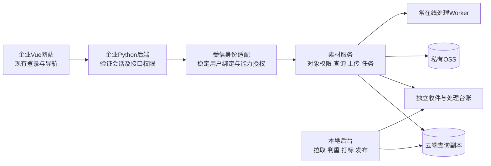

# 企业网站与账户体系接入方案

2026-11-10双仓首轮更新：用户已授权M-006，media-tag保留本地打标，media-cloud独立维护发布接收/查询下载；当前实现与范围以[双仓发布说明](cloud-publication.md)为准。下文单仓建议保留为历史背景，已由双仓决定替代；首轮不生产部署，真实OSS/ECS、云端处理、收件与企业认证尚待后续。

2026-11-09。用户要求接入现有企业网站与账户体系，已说明后端Python、前端Vue；具体框架、项目路径、登录协议、用户/角色字段及域名尚未取得。本文为拟定方案，未读取企业项目、修改其代码/账号、实施登录对接或部署。保留同一素材仓库内的本地生产端/云端服务与在线处理Worker，企业网站是人员使用入口。

## 接入方式

推荐在企业Vue网站增加“素材库、素材处理、我的任务”，按权限提供“待入库/素材管理”。企业Python后端验证现有登录，向素材服务提供已核验身份；素材API、在线Worker和OSS继续独立运行。员工沿用企业账号，素材系统不另收员工密码，也不向浏览器发放现有本地管理员/Worker长期凭证。

首选同域名部署，由企业后端或受控网关转发素材API；页面路由如 `/media/library`、`/media/process`、`/media/tasks` 仅为拟定示例。前端展示/隐藏菜单不代替后端鉴权；查询、上传、处理、预览、下载和复核每次仍检查权限。大文件按现有分块/流式方式转发，不能在8GB服务器中一次把整段视频读入内存。

不要直接iframe嵌入当前人员页来冒充集成：现有页面明确禁止被frame嵌入，接口/资源路径、同源会话与代理后的HTTPS也需适配。优先让Vue使用受保护API；若选择复用现有页面另设入口，则需单独验证统一登录、路径和浏览器策略，不直接放宽现有保护。

## 复用现有登录

| 企业已有条件 | 拟定实现 |
| --- | --- |
| 企业Python后端维护Session/Cookie或JWT | 企业后端按原规则核验登录，再经内部接口调用素材服务；不猜测Cookie格式、不直接读取账户数据库来绕过现有登录逻辑 |
| 已有OIDC统一身份服务 | 用已注册客户端接现有身份服务，验证发行者、接收方、签名/有效期及登录流程绑定；不把任意JWT字符串当作已登录 |
| 自定义登录校验接口 | 先读取真实契约，再做服务端会话验证/身份交换；协议未提供前不编造可运行端点或字段 |

OIDC相关要求依据[OpenID Connect Core](https://openid.net/specs/openid-connect-core-1_0.html)；如现有服务提供OAuth令牌内省，可按[RFC 7662](https://www.rfc-editor.org/rfc/rfc7662.html)验证active及相应身份/范围。Python/Vue技术栈本身不能说明使用何种认证协议，也不要求为了接入而先更换企业登录系统。

内部调用采用受限服务身份并携带服务端核验的用户上下文，或短时且指定接收服务的身份断言；具体方式依真实项目确定。素材服务必须确认请求来自受信后端/网关，不能信任浏览器自行提交的user_id、role或身份请求头。代理清除外来同名身份头并阻止绕过入口直接访问内部接口；相关依据见[RFC 9700第4.13节](https://www.rfc-editor.org/rfc/rfc9700.html#section-4.13)。

企业会话、内部调用凭证和处理Worker凭证分别管理。使用Cookie时保留CSRF/来源校验，代理转发只信任指定来源，HTTPS和Cookie作用域按真实域名配置；不把企业会话Cookie复制到其他域或写入素材清单/OSS对象。

## 身份与权限

以企业提供的不可变用户ID建立至素材 `actor_id` 的持久绑定，必要时带身份来源/组织命名空间。用户名、显示名和邮箱可变，不能当唯一长期身份，也不能靠名字相同把现有本地owner自动转给企业用户。旧素材/修订/审核历史保持原身份，已有账号如何绑定需核对真实人员后操作。

| 业务能力 | 授权边界 |
| --- | --- |
| 查询、预览、下载 | 企业已登录且有对应素材/固定版本read权限；登录不等于全库可见 |
| 上传、变速、打码 | 需显式业务能力、输入访问权及配额；本人工作结果按当前隐私复核规则访问 |
| 素材管理、发布与来源修订 | 显式素材管理角色，保留对象/版本和操作审计 |
| 输出复核、医学审核、词表审核/发布 | 继续分别指定，企业管理员不自动取得全部业务审核能力 |
| 本地同步、云端处理、AI剪辑客户端 | 独立受限服务身份；不复用员工浏览器会话或共享全局管理员账号 |

当前`Principal`只有reader/editor/admin/worker，素材权限仍按owner及逐对象授权判断；拟定能力不意味着这些字段已经存在。需在服务端实现身份映射与能力校验，不能把企业role原值直接转换为内部admin，也不能让普通上传账户获得全库编辑权。当前设计面向一套企业账户体系，不把组织ID字段当作已有多企业租户隔离实现。

企业停用、登出和权限收紧需接实际撤销机制及有界身份缓存，明确失效时延；后台查询快照回退不能重新启用账号/访问权。上传、处理、复核、下载记录关联稳定人员ID和独立服务身份，脱敏日志不含密码、完整Cookie、令牌或临时签名URL。本地导入时保留企业上传人及来源，不以同步Worker身份冒充实际上传者。

## 实施顺序与当前缺口

1. 取得企业项目路径或仓库及必要接口文档，核对Python框架、Vue路由、Session/JWT/SSO、稳定用户ID、角色、停用/退出机制及同域代理条件；不读取相邻项目`.env`。
2. 冻结身份适配及业务能力契约；用隔离测试身份验证登录失效、角色映射和内部入口约束，再接云端查询/收件/在线任务。未具备真实接口前不先实现猜测版认证。
3. 在企业Vue接页面/导航与任务进度，在企业Python接受信服务调用；素材库和处理结果分别展示，不等本地打标入库才给用户结果。
4. 验证伪造user_id/role/头、错误签名/接收方/发行者、过期/停用/退出、跨用户取文件、未复核输出、CSRF、代理绕过及上传/Range；再做真实账号与云端资源联调。

现有身份入口位于`src/media_tag/api/app.py`，仅支持受信配置中的Bearer摘要及本服务会话；`web/http.py`的本机票据仅用于本地入口。尚无企业SSO、身份绑定/生命周期同步、Vue企业页面或企业后端适配。上述属于D01/D07/D09/D12/D17及D18/D20跨端验证的新增交付点，不另增D任务卡或计完成。
